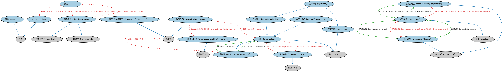

# Commons 组织本体（Commons Organizations Ontology）结构与公理说明

本文档对应 `Organizations.rdf` / `Organizations.ttl`，说明该本体的类、继承关系、属性和公理约定。结构图见 `Organizations-structure.png`（`Organizations-structure.svg` 为可缩放版本）。

## 1. 本体概述

定义组织（organization）、组织成员、组织内部结构与角色：公司、机构、团体等通用组织模型。

**在体系中的位置**：Commons 的核心业务模块之一，是 FIBO 正式组织、BE 各类法律实体的上层基础。

**上下游关系**：上游依赖参与方与情境、角色与构成、地点、标识符、分类等模块；下游被登记主管机构、监管机构、场所与设施模块引用。

**与相近概念的差别**：组织≠参与方——组织是「有结构的团体」这一实体，参与方是「进入某关系的主体」这一角色；一个组织只有签约、交易时才成为参与方。

本本体中类与类的核心关系如下（完整细节见各类小节）：

- **正式组织（FormalOrganization）** 继承 **组织（Organization）**
- **非正式组织（InformalOrganization）** 继承 **组织（Organization）**
- **组织（Organization）** 继承 **参与方（party）**
- **组织标识符（OrganizationIdentifier）** 继承 **标识符（Identifier）**
- **组织成员（OrganizationMember）** 继承 **参与方角色（party role）**
- **组织名称（OrganizationName）** 继承 **情境化名称（ContextualName）**
- **组织子单位标识符（OrganizationSubUnitIdentifier）** 继承 **标识符（Identifier）**
- **组织子单位（OrganizationalSubUnit）** 继承 **组织（Organization）**
- **能力（capability）** 继承 **方面（Aspect）**
- **容量（capacity）** 继承 **方面（Aspect）**
- **法律实体（legal entity）** 继承 **正式组织（FormalOrganization）**
- **法律实体（legal entity）** 继承 **法律主体（legal person）**
- 其余 12 条关系从略。

## 2. 类（Class）

| 类（Class） | 定义（Definition） |
|---|---|
| 正式组织（FormalOrganization） | 在某个法律管辖区内得到承认、具有相应权利与责任的组织。 |
| 非正式组织（InformalOrganization） | 为共同目的走到一起但未构成法律实体的个人群体。 |
| 组织（Organization） | 个人、多人或群体为某种目的（如满足需求或追求共同目标）在其中行动或被指定行动的权威框架。 |
| 组织标识符（OrganizationIdentifier） | 在组织标识方案内分配给组织、且在该方案内唯一的标识符。 |
| 组织成员（OrganizationMember） | 对某组织具有成员角色的参与方（个人或组织）。 |
| 组织名称（OrganizationName） | 某组织在某情境中为人所知的指称。 |
| 组织子单位标识符（OrganizationSubUnitIdentifier） | 分配给特定组织子单位的标识符。 |
| 组织子单位（OrganizationalSubUnit） | 较大组织内部的任何部门或其他实体，仅在该组织情境内得到完全承认，但因某种目的需要标识。 |
| 能力（capability） | 执行特定职能或达成特定结果的能力。 |
| 容量（capacity） | 在规定条件下某事物或某人执行职能或产出成果的最大限度。 |
| 法律实体（legal entity） | 作为合伙、公司或其他组织的法律主体，具有订立合同、承担财务义务和清偿债务的能力。 |
| 法律主体（legal person） | 在法律下被承认享有权利与义务的参与方，包括但不限于起诉与被诉、订立合同、拥有财产的权利。 |
| 含成员组织（member-bearing organization） | 拥有成员（个人或其他组织）的团体或组织所扮演的角色。 |
| 成员关系（membership） | 对应 n 元关系的情形：某团体或组织在某时期内拥有至少一名成员（个人或组织）。 |
| 组织标识方案（organization identification scheme） | 专用于唯一标识组织的标识方案。 |
| 服务（service） | 某参与方为另一参与方的利益执行的无形活动。 |
| 服务提供方（service provider） | 提供某种服务（包括但不限于商业或专业服务）的代理所扮演的角色。 |

以下按类逐个展开：每个类给出继承关系、相关属性与公理约定；子类在父类之下降一级编号。

### 2.1 组织（Organization）

定义：个人、多人或群体为某种目的（如满足需求或追求共同目标）在其中行动或被指定行动的权威框架。

- 父类：**参与方（party）**
- 直接子类：**正式组织（FormalOrganization）**、**非正式组织（InformalOrganization）**、**组织子单位（OrganizationalSubUnit）**

属性：

| 属性 | 定义 | 说明 |
|---|---|---|
| **具有成员（hasMember）** | — | — |
| **具有部分（hasPart）** | — | — |
| **具有名称（hasName）** | — | — |
| **具有子单位（has sub-unit）** | 将一个组织关联到其组成部分。 | 值域：组织子单位（OrganizationalSubUnit）；逆属性：是……的子单位（is sub-unit of）；子属性：具有部分 |

公理：

- **具有名称（hasName）**可以有 0 个或多个**组织名称（OrganizationName）**。
- **具有成员（hasMember）**的所有取值只能是**参与方（party）**。
- **具有部分（hasPart）**的所有取值只能是**组织（Organization）**。

#### 2.1.1 正式组织（FormalOrganization）

定义：在某个法律管辖区内得到承认、具有相应权利与责任的组织。

- 父类：**组织（Organization）**
- 直接子类：**法律实体（legal entity）**

属性：

| 属性 | 定义 | 说明 |
|---|---|---|
| **注册于（is domiciled in）** | 标识实体在某国开展业务的主要地点，如总部所在地。 | 值域：地缘政治实体；子属性：具有区域 |

公理：

- **注册于（is domiciled in）**可以有 0 个或多个**地缘政治实体（GeopoliticalEntity）**。
- 与**非正式组织（InformalOrganization）**互斥：同一个体不能同时属于两者。

##### 2.1.1.1 法律实体（legal entity）

定义：作为合伙、公司或其他组织的法律主体，具有订立合同、承担财务义务和清偿债务的能力。

- 父类：**正式组织（FormalOrganization）**、**法律主体（legal person）**

#### 2.1.2 非正式组织（InformalOrganization）

定义：为共同目的走到一起但未构成法律实体的个人群体。

- 父类：**组织（Organization）**

#### 2.1.3 组织子单位（OrganizationalSubUnit）

定义：较大组织内部的任何部门或其他实体，仅在该组织情境内得到完全承认，但因某种目的需要标识。

- 父类：**组织（Organization）**

属性：

| 属性 | 定义 | 说明 |
|---|---|---|
| **是……的部分（isPartOf）** | — | — |
| **是……的子单位（is sub-unit of）** | 将组织的组成部分关联到更大的实体。 | 值域：组织（Organization）；子属性：是……的部分 |

公理：

- **是……的部分（isPartOf）**的所有取值只能是**组织（Organization）**。

### 2.2 组织标识符（OrganizationIdentifier）

定义：在组织标识方案内分配给组织、且在该方案内唯一的标识符。

- 父类：**标识符（Identifier）**

属性：

| 属性 | 定义 | 说明 |
|---|---|---|
| **是……的成员（isMemberOf）** | — | — |
| **标识（identifies）** | — | — |

公理：

- **是……的成员（isMemberOf）**恰好有 1 个**组织标识方案（organization identification scheme）**。
- **标识（identifies）**至少有一个取值，类型是**组织（Organization）**。

### 2.3 组织成员（OrganizationMember）

定义：对某组织具有成员角色的参与方（个人或组织）。

- 父类：**参与方角色（party role）**

属性：

| 属性 | 定义 | 说明 |
|---|---|---|
| **是组织成员（is organization member）** | 标识参与方扮演组织成员角色的成员关系情境。 | 值域：成员关系（membership）；子属性：承受（undergoes） |
| **由…扮演（is played by）** | — | — |

公理：

- **由…扮演（is played by）**至少有一个取值，该取值满足：**是……的成员（isMemberOf）**的所有取值只能是**组织（Organization）**。

### 2.4 组织名称（OrganizationName）

定义：某组织在某情境中为人所知的指称。

- 父类：**情境化名称（ContextualName）**

属性：

| 属性 | 定义 | 说明 |
|---|---|---|
| **是……的名称（isNameOf）** | — | — |

公理：

- **是……的名称（isNameOf）**可以有 0 个或多个**组织（Organization）**。

### 2.5 组织子单位标识符（OrganizationSubUnitIdentifier）

定义：分配给特定组织子单位的标识符。

- 父类：**标识符（Identifier）**

属性：

| 属性 | 定义 | 说明 |
|---|---|---|
| **标识（identifies）** | — | — |

公理：

- **标识（identifies）**至少有一个取值，类型是**组织子单位（OrganizationalSubUnit）**。

### 2.6 能力（capability）

定义：执行特定职能或达成特定结果的能力。

- 父类：**方面（Aspect）**

### 2.7 容量（capacity）

定义：在规定条件下某事物或某人执行职能或产出成果的最大限度。

- 父类：**方面（Aspect）**

### 2.8 法律主体（legal person）

定义：在法律下被承认享有权利与义务的参与方，包括但不限于起诉与被诉、订立合同、拥有财产的权利。

- 父类：**参与方（party）**
- 直接子类：**法律实体（legal entity）**

### 2.9 含成员组织（member-bearing organization）

定义：拥有成员（个人或其他组织）的团体或组织所扮演的角色。

- 父类：**参与方角色（party role）**

属性：

| 属性 | 定义 | 说明 |
|---|---|---|
| **在……中为成员方（is membership party in）** | 标识参与方扮演「拥有成员」角色的成员关系情形。 | 值域：成员关系（membership）；子属性：在…中行动（acts in） |
| **由…扮演（is played by）** | — | — |

公理：

- **由…扮演（is played by）**至少有一个取值，该取值满足：**具有成员（hasMember）**至少有一个取值，类型是**参与方（party）**。

### 2.10 成员关系（membership）

定义：对应 n 元关系的情形：某团体或组织在某时期内拥有至少一名成员（个人或组织）。

- 父类：**情境（situation）**

属性：

| 属性 | 定义 | 说明 |
|---|---|---|
| **具有成员关系（has membership）** | 标识在组织成员关系情形中扮演「拥有成员」角色的组织。 | 值域：含成员组织（member-bearing organization）；逆属性：在……中为成员方（is membership party in）；子属性：具有行为者（has actor） |
| **具有组织成员（has organization member）** | 标识在组织成员关系情形中扮演成员角色的参与方。 | 值域：组织成员（OrganizationMember）；逆属性：是组织成员（is organization member）；子属性：具有承受者（has undergoer） |

公理：

- **具有成员关系（has membership）**至少有一个取值，类型是**含成员组织（member-bearing organization）**。
- **具有组织成员（has organization member）**至少有一个取值，类型是**组织成员（OrganizationMember）**。

### 2.11 组织标识方案（organization identification scheme）

定义：专用于唯一标识组织的标识方案。

- 父类：**标识方案（IdentificationScheme）**

### 2.12 服务（service）

定义：某参与方为另一参与方的利益执行的无形活动。

属性：

| 属性 | 定义 | 说明 |
|---|---|---|
| **由……提供（is provided by）** | 由……使之可获得。 | 逆属性：提供（provides） |
| **提供（provides）** | 使之可获得。 | — |

公理：

- **提供（provides）**可以有 0 个或多个**能力（capability）**。
- **由……提供（is provided by）**至少有一个取值，类型是**服务提供方（service provider）**。

### 2.13 服务提供方（service provider）

定义：提供某种服务（包括但不限于商业或专业服务）的代理所扮演的角色。

- 父类：**智能体角色（agent role）**、**功能角色（functional role）**

属性：

| 属性 | 定义 | 说明 |
|---|---|---|
| **提供（provides）** | 使之可获得。 | — |

公理：

- **提供（provides）**至少有一个取值，类型是**服务（service）**。

## 3. 其他属性

以下属性未绑定到本体的具体类（定义域在外部本体或未声明）：

对象属性（Object Property）：

| 属性 | 定义 | 说明 |
|---|---|---|
| **指定（designates）** | 正式任命某人。 | 值域：参与方角色（party role）；子属性：具有相关参与方角色（has related party role） |
| **由……指定（is designated by）** | 标识指派或任命某人担任职务的参与方角色。 | 值域：参与方角色（party role）；逆属性：指定（designates）；子属性：具有相关参与方角色（has related party role） |
| **由……管理（is managed by）** | 标识指挥某事物或某人事务或行政管理的参与方角色。 | 值域：参与方角色（party role）；子属性：具有参与方角色（has party role） |
| **提供给（is provided to）** | 使之可被……获得。 | — |
| **管理（manages）** | 将参与方角色关联到其以某种方式指挥或管理的事物或人。 | 逆属性：由……管理（is managed by）；子属性：是…中的角色（is role in） |

数据属性（Datatype Property）：

| 属性 | 定义 |
|---|---|
| **具有网址（has URL）** | 将某事物链接到指明其在计算机网络中的位置及检索方法的网络资源。 |
| **具有网站（has website）** | 将某事物链接到位于单一域名下的网页或相关网页集合。 |

## 4. 依赖（owl:imports，9 个）

本本体通过 `owl:imports` 引入以下本体，各项的中文名称与简介如下：

| 导入本体 | 中文名称 | 简介 |
|---|---|---|
| `AnnotationVocabulary/AnnotationVocabulary.rdf` | Commons 标注词汇表（Commons Annotation Vocabulary） | 提供文档标注常用的属性，如摘要、定义、解释、版权、同义词等，并梳理 SKOS 与 Dublin Core 标注属性之间的关系。 |
| `Classifiers/Classifiers.rdf` | Commons 分类器本体（Commons Classifiers Ontology） | 定义用于对事物进行分类、分面或归类的通用概念。 |
| `Collections/Collections.rdf` | Commons 集合本体（Commons Collections Ontology） | 定义集合、成员关系及集合操作的基础概念。 |
| `ContextualDesignators/ContextualDesignators.rdf` | Commons 上下文指称本体（Commons Contextual Designators Ontology） | 定义在特定上下文中有意义的指称、名称和标识符。 |
| `Designators/Designators.rdf` | Commons 指称本体（Commons Designators Ontology） | 定义名称、标识符等指称事物的通用概念。 |
| `Identifiers/Identifiers.rdf` | Commons 标识符本体（Commons Identifiers Ontology） | 定义标识符及其发布、管理与解析的基础概念。 |
| `Locations/Locations.rdf` | Commons 位置本体（Commons Locations Ontology） | 定义地址、地理区域、位置及其关系。 |
| `PartiesAndSituations/PartiesAndSituations.rdf` | Commons 参与方与情境本体（Commons Parties and Situations Ontology） | 定义参与方、角色、情境以及它们之间关系的高层概念，是 FIBO 等多领域的上层本体。 |
| `RolesAndCompositions/RolesAndCompositions.rdf` | Commons 角色与组合本体（Commons Roles and Compositions Ontology） | 定义角色、组合及其扮演/组成关系的基础本体。 |

## 5. 文件

- 官方 RDF/XML：`Organizations.rdf`
- 中文 Turtle：`Organizations.ttl`
- 结构图：`Organizations-structure.png` / `Organizations-structure.svg`