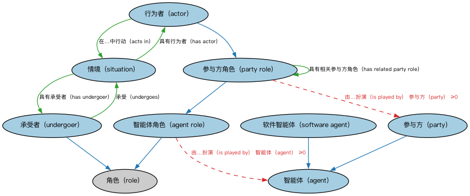

# Commons 参与方与情境本体（Commons Parties and Situations Ontology）结构与公理说明

本文档对应 `PartiesAndSituations.rdf` / `PartiesAndSituations.ttl`，说明该本体的类、继承关系、属性和公理约定。结构图见 `PartiesAndSituations-structure.png`（`PartiesAndSituations-structure.svg` 为可缩放版本）。

## 1. 本体概述

定义参与方（party）、行为者（actor）、承受者（undergoer）与情境（situation）：描述「谁、在什么场景下、扮演什么角色」的核心框架，是 Commons 最具代表性的模块。

**在体系中的位置**：Commons 的核心模块，组织、授权、登记、监管等业务模块都建立在它之上；FIBO 的参与方本体直接继承它。

**上下游关系**：上游依赖角色与构成、语境指称、指称符、日期、集合模块；下游被组织、业务授权、登记主管机构、监管机构引用。

**与相近概念的差别**：参与方≠行为者——行为者强调「主动做事」的一方，承受者是「被影响」的一方；情境≠事件——情境是一段时间内相对稳定的关系状态，事件是时间点上的发生。

本本体中类与类的核心关系如下（完整细节见各类小节）：

- **行为者（actor）** 继承 **参与方角色（party role）**
- **智能体角色（agent role）** 继承 **角色（role）**
- **参与方（party）** 继承 **智能体（agent）**
- **参与方角色（party role）** 继承 **智能体角色（agent role）**
- **软件智能体（software agent）** 继承 **智能体（agent）**
- **承受者（undergoer）** 继承 **角色（role）**
- **行为者（actor）** 通过 **在…中行动（acts in）** 关联 **情境（situation）**
- **情境（situation）** 通过 **具有行为者（has actor）** 关联 **行为者（actor）**
- **参与方角色（party role）** 通过 **具有相关参与方角色（has related party role）** 关联 **参与方角色（party role）**
- **情境（situation）** 通过 **具有承受者（has undergoer）** 关联 **承受者（undergoer）**
- **承受者（undergoer）** 通过 **承受（undergoes）** 关联 **情境（situation）**

## 2. 类（Class）

| 类（Class） | 定义（Definition） |
|---|---|
| 行为者（actor） | 参与方之间关系中的主要执行者，即做出某事、导致某事发生或以其他方式在关系中扮演施事角色的参与方。 primary performer in a relationship between parties, i.e., the party that does something, causes something to happen, or otherwise plays an agentive role in the relationship |
| 智能体（agent） | 能够适应环境并与之交互的自主事物。 something autonomous that can adapt to and interact with its environment |
| 智能体角色（agent role） | 任何智能体所扮演的角色。 role played by any agent |
| 参与方（party） | 个人或组织。 person or organization |
| 参与方角色（party role） | 由组织或个人扮演的、可能具有时间边界的角色。 role played by an organization or individual that may be time bound |
| 情境（situation） | 在一段时间内相对稳定的场景、状态或关系。 setting, state of being, or relationship that is relatively stable for some period of time |
| 软件智能体（software agent） | 感知环境并采取行动以最大化实现其目标的数字实体。 digital entity that perceives its environment and takes actions that maximize its chance of successfully achieving its goals |
| 承受者（undergoer） | 在情境中扮演客体或接受者角色的事物（或参与方），即被情境影响的对象，或扮演被动接受者/受事角色的实体。 something that plays the role of the object or recipient in a situation, i.e., the thing (or party) that the situation impacts, affects, or that otherwise plays a passive recipient / patient or thematic role |

以下按类逐个展开：每个类给出继承关系、相关属性与公理约定；子类在父类之下降一级编号。

### 2.1 智能体（agent）

定义：能够适应环境并与之交互的自主事物。

- 直接子类：**参与方（party）**、**软件智能体（software agent）**

属性：

| 属性 | 定义 | 说明 |
|---|---|---|
| **具有名称（hasName）** | — | — |

公理：

- **具有名称（hasName）**可以有 0 个或多个**情境化名称（ContextualName）**。
- 与**角色（role）**互斥：同一个体不能同时属于两者。

#### 2.1.1 参与方（party）

定义：个人或组织。

- 父类：**智能体（agent）**

属性：

| 属性 | 定义 | 说明 |
|---|---|---|
| **是…的参与方（is a party to）** | 识别参与方所关联的协议、合同、政策、规章、情境或其他安排。 identifies an agreement, contract, policy, regulation, situation, or other arrangement that a party is associated with | 逆属性：具有参与方（has party） |

#### 2.1.2 软件智能体（software agent）

定义：感知环境并采取行动以最大化实现其目标的数字实体。

- 父类：**智能体（agent）**

公理：

- 与**参与方（party）**互斥：同一个体不能同时属于两者。

### 2.2 智能体角色（agent role）

定义：任何智能体所扮演的角色。

- 父类：**角色（role）**
- 直接子类：**参与方角色（party role）**

属性：

| 属性 | 定义 | 说明 |
|---|---|---|
| **由…扮演（is played by）** | — | — |

公理：

- **由…扮演（is played by）**可以有 0 个或多个**智能体（agent）**。

#### 2.2.1 参与方角色（party role）

定义：由组织或个人扮演的、可能具有时间边界的角色。

- 父类：**智能体角色（agent role）**
- 直接子类：**行为者（actor）**

属性：

| 属性 | 定义 | 说明 |
|---|---|---|
| **具有适用期间（hasApplicablePeriod）** | — | — |
| **具有相关参与方角色（has related party role）** | 将扮演某一具体角色的参与方直接关联到扮演相同或另一角色的另一参与方。 relates a party acting in a specific role directly to another party acting in the same or another role | 值域：参与方角色（party role）；子属性：具有角色（has role） |
| **由…扮演（is played by）** | — | — |

公理：

- **具有适用期间（hasApplicablePeriod）**可以有 0 个或多个**日期区间（DatePeriod）**。
- **由…扮演（is played by）**可以有 0 个或多个**参与方（party）**。

##### 2.2.1.1 行为者（actor）

定义：参与方之间关系中的主要执行者，即做出某事、导致某事发生或以其他方式在关系中扮演施事角色的参与方。

- 父类：**参与方角色（party role）**

属性：

| 属性 | 定义 | 说明 |
|---|---|---|
| **在…中行动（acts in）** | 指出行为者扮演主要角色的情境。 indicates a situation in which the actor plays a primary role | 值域：情境（situation）；逆属性：具有行为者（has actor）；子属性：是…中的主体角色（is subject role in） |

### 2.3 情境（situation）

定义：在一段时间内相对稳定的场景、状态或关系。

属性：

| 属性 | 定义 | 说明 |
|---|---|---|
| **具有行为者（has actor）** | 识别在特定情境中扮演特定角色并起主要作用的参与方。 identifies the primary party acting in a specific role with respect to a given situation | 值域：行为者（actor）；子属性：具有参与方角色（has party role） |
| **具有客体角色（has object role）** | 识别被特定关系或情境影响，或在该关系中充当次要参数的人或事物。 identifies a person or thing that is affected by, or is a secondary argument in a specific role with respect to a given relation or situation | 值域：角色（role）；子属性：具有角色（has role） |
| **具有主体角色（has subject role）** | 识别在特定情境中是讨论、描述、处理对象或主要主题的人或事物。 identifies the person or thing that is being discussed, described, dealt with, or is the main topic in a specific role with respect to a given situation | 值域：角色（role）；子属性：具有角色（has role） |
| **具有承受者（has undergoer）** | 识别给定情境中作为经历者、被动或其他客体角色的实体。 identifies an experiencer / passive or other object role in a given situation | 值域：承受者（undergoer）；子属性：具有客体角色（has object role） |
| **在…期间保持（holds during）** | 指示某事物为真的日期时间段。 indicates a date period during which something is true | 值域：日期区间；子属性：具有适用期间 |

公理：

- **具有主体角色（has subject role）**至少有一个取值，类型是**角色（role）**。
- **具有客体角色（has object role）**可以有 0 个或多个**角色（role）**。
- **在…期间保持（holds during）**可以有 0 个或多个**日期区间（DatePeriod）**。

### 2.4 承受者（undergoer）

定义：在情境中扮演客体或接受者角色的事物（或参与方），即被情境影响的对象，或扮演被动接受者/受事角色的实体。

- 父类：**角色（role）**

属性：

| 属性 | 定义 | 说明 |
|---|---|---|
| **承受（undergoes）** | 指示承受者所经历的情境。 indicates a situation that the undergoer experiences | 值域：情境（situation）；逆属性：具有承受者（has undergoer）；子属性：是…中的客体角色（is object role in） |

## 3. 其他属性

以下属性未绑定到本体的具体类（定义域在外部本体或未声明）：

对象属性（Object Property）：

| 属性 | 定义 | 说明 |
|---|---|---|
| **对…采取行动（acts on）** | 将情境中的行为者与其在特定情形下影响的承受者关联起来。 relates an actor in a given situation to the undergoer that they affect under the circumstances | 逆属性：受…影响（is affected by） |
| **直接影响（directly affects）** | 将情境中的行为者与其在特定情形下直接影响的事物（或参与方）关联起来。 relates an actor in a given situation to the thing (or party) that they impact under the circumstances | 逆属性：与…共同经历（experiences with） |
| **经历（experiences）** | 将某事物与以某种方式影响它的情境关联起来。 relates something to a situation that affects them in some way | — |
| **直接经历（experiences directly）** | 将某事物直接关联到驱动涉及该事物的情境的参与方。 relates something directly to a party that drives a situation involving it | — |
| **与…共同经历（experiences with）** | 将某事物关联到驱动涉及该事物的情境的行为者。 relates something to an actor that drives a situation involving it | — |
| **具有主动参与方（has active party）** | 将情境关联到以主要（施事）角色行动的个人或组织。 relates a situation to the person or organization acting in a primary (agentive) role | 逆属性：在…中扮演主动参与方（plays active party in） |
| **具有主动角色（has active role）** | 将情境关联到以主要（施事）角色行动的事物。 relates a situation to something that is acting in a primary (agentive) role | 逆属性：在…中扮演主动角色（plays active role in） |
| **具有参与方（has party）** | 识别与协议、合同、政策、规章、情境或其他安排相关联的参与方。 identifies a party associated with an agreement, contract, policy, regulation, situation, or other arrangement | 值域：参与方（party） |
| **具有参与方角色（has party role）** | 识别某个人或组织在与情境、协议、合同、政策、规章、活动或其他关系相关的方面所扮演的具体角色。 identifies a specific role played by some person or organization as related to a situation, agreement, contract, policy, regulation, activity or other relationship | 值域：参与方角色（party role）；子属性：具有角色（has role） |
| **受…影响（is affected by）** | 将情境中的承受者关联到在特定情形下对其产生影响的行为者。 relates an undergoer in a given situation to the actor that has an impact on them under the circumstances | — |
| **直接受…影响（is directly affected by）** | 将情境中的承受者关联到在特定情形下对其产生直接影响的人或组织。 relates an undergoer in a given situation to the person or organization that has an impact on them under the circumstances | — |
| **被…经历（is experienced by）** | 将情境关联到直接参与或受其影响的事物。 relates a situation to something that is directly involved in or affected by it | 逆属性：经历（experiences） |
| **是…中的客体角色（is object role in）** | 指示该角色为次要角色的情境，例如经历者或被动参与者。 indicates a situation in which the role is secondary, such as an experiencer or passive participant | 值域：N0e822e49eb584acf9ca96c9b39d3c2d9；逆属性：具有客体角色（has object role）；子属性：是…中的角色（is role in） |
| **在…中实现（is realized in）** | 将情境或组成关联到被特定关系或情境影响或作为其次要参数的事物。 relates a situation or constituency to something that is affected by, or is a secondary argument to in a specific role with respect to a given relation or situation | 逆属性：实现（realizes） |
| **是…中的主体角色（is subject role in）** | 指示该角色为主要主题的情境。 indicates a situation in which the role is the primary topic | 值域：情境（situation）；逆属性：具有主体角色（has subject role）；子属性：是…中的角色（is role in） |
| **在…中扮演主动参与方（plays active party in）** | 将个人或组织关联到其直接参与的情境。 relates a person or organization to a situation that they are directly involved in | — |
| **在…中扮演主动角色（plays active role in）** | 将某事物关联到其直接参与的情境。 relates something to a situation that it is directly involved in | — |
| **扮演影响…的主动角色（plays active role that affects）** | 将个人或组织关联到其在特定情形下产生影响的承受者。 relates a person or organization to an undergoer they have an impact on under the circumstances | 逆属性：直接受…影响（is directly affected by） |
| **扮演直接影响…的主动角色（plays active role that directly affects）** | 将个人或组织关联到其在特定情形下直接影响的事物。 relates a person or organization to something they have a direct impact on under the circumstances | 逆属性：直接经历（experiences directly） |
| **实现（realizes）** | 将某事物关联到其扮演的角色为次要角色的情境或组成，例如经历者或被动参与者。 relates something to a situation or constituency in which the role they play is secondary, such as an experiencer or passive participant | — |

## 4. 依赖（owl:imports，6 个）

本本体通过 `owl:imports` 引入以下本体，各项的中文名称与简介如下：

| 导入本体 | 中文名称 | 简介 |
|---|---|---|
| `AnnotationVocabulary/AnnotationVocabulary.rdf` | Commons 标注词汇表（Commons Annotation Vocabulary） | 提供文档标注常用的属性，如摘要、定义、解释、版权、同义词等，并梳理 SKOS 与 Dublin Core 标注属性之间的关系。 |
| `Collections/Collections.rdf` | Commons 集合本体（Commons Collections Ontology） | 定义集合、成员关系及集合操作的基础概念。 |
| `ContextualDesignators/ContextualDesignators.rdf` | Commons 上下文指称本体（Commons Contextual Designators Ontology） | 定义在特定上下文中有意义的指称、名称和标识符。 |
| `DatesAndTimes/DatesAndTimes.rdf` | Commons 日期与时间本体（Commons Dates and Times Ontology） | 定义日期、时间、时间段及其表示方式。 |
| `Designators/Designators.rdf` | Commons 指称本体（Commons Designators Ontology） | 定义名称、标识符等指称事物的通用概念。 |
| `RolesAndCompositions/RolesAndCompositions.rdf` | Commons 角色与组合本体（Commons Roles and Compositions Ontology） | 定义角色、组合及其扮演/组成关系的基础本体。 |

## 5. 文件

- 官方 RDF/XML：`PartiesAndSituations.rdf`
- 中文 Turtle：`PartiesAndSituations.ttl`
- 结构图：`PartiesAndSituations-structure.png` / `PartiesAndSituations-structure.svg`