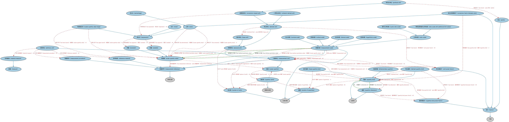

# Commons 量与单位本体（Commons Quantities and Units Ontology）结构与公理说明

本文档对应 `QuantitiesAndUnits.rdf` / `QuantitiesAndUnits.ttl`，说明该本体的类、继承关系、属性和公理约定。结构图见 `QuantitiesAndUnits-structure.png`（`QuantitiesAndUnits-structure.svg` 为可缩放版本）。

## 1. 本体概述

定义量（quantity）、度量单位（measurement unit）、量纲（dimension）与度量体系：长度、重量、货币、比率等一切数值度量的通用模型，是 Commons 中类最多的模块（47 个类）。

**在体系中的位置**：Commons 的度量基础模块，为金额、面积、汇率等数值表达提供支撑。

**上下游关系**：上游依赖分类、集合、语境指称、指称符、文档模块；下游被地点等模块及各行业本体（含 FIBO 货币金额概念）引用。

**与相近概念的差别**：量≠数值——量是「数值＋单位＋量纲」的完整结构（5 公里），数值只是数字；单位≠量纲——量纲是物理类别（长度），单位是具体刻度（公里、英里）。

本本体中类与类的核心关系如下（完整细节见各类小节）：

- **任意单位（arbitrary unit）** 继承 **计量单位（measurement unit）**
- **基本量类（base quantity kind）** 继承 **量类（quantity kind）**
- **基本单位（base unit）** 继承 **物理单位（physical unit）**
- **一贯导出单位（coherent derived unit）** 继承 **导出单位（derived unit）**
- **常量（constant）** 继承 **标量值（scalar quantity value）**
- **单位间换算因子（conversion factor between units）** 继承 **因子（factor）**
- **单位间换算因子（conversion factor between units）** 继承 **比率（ratio）**
- **换算型单位（conversion-based unit）** 继承 **导出单位（derived unit）**
- **循环比率标度（cyclic ratio scale）** 继承 **比率标度（ratio scale）**
- **导出量类（derived quantity kind）** 继承 **量类（quantity kind）**
- **导出单位（derived unit）** 继承 **物理单位（physical unit）**
- **无量纲量（dimensionless quantity）** 继承 **量类（quantity kind）**
- 其余 34 条关系从略。

## 2. 类（Class）

| 类（Class） | 定义（Definition） |
|---|---|
| 任意单位（arbitrary unit） | 任意定义的计量单位，其与国际单位制物理单位的关系不存在或未知。 arbitrarily defined unit of measurement, where a relation of the unit to a physical unit of the SI does not exist or is unknown |
| 基本量类（base quantity kind） | 在约定选取的量子集之内的量，该子集中的任何量都不能用子集内其他量表示。 quantity in a conventionally chosen subset of a given system of quantities, where no quantity in the subset can be expressed in terms of the other quantities within that subset |
| 基本单位（base unit） | 由单位制定义为基本量参考计量单位的计量单位。 measurement unit that is defined by a system of units to be the reference measurement unit for a base quantity |
| 一贯导出单位（coherent derived unit） | 对给定量制和选定基本单位集，由基本单位的幂之积构成且比例因子仅为一的导出单位。 derived unit that, for a given system of quantities and for a chosen set of base units, is a product of powers of base units with no other proportionality factor than one |
| 常量（constant） | 在公式或表达式中表示不变（即固定）值的符号。 symbol that represents a value that does not change (i.e., is fixed) with respect to a formula or expression |
| 单位间换算因子（conversion factor between units） | 同类量的两个计量单位之比。 ratio of two measurement units for quantities of the same kind |
| 换算型单位（conversion-based unit） | 通过与另一参考单位的显式换算关系定义的导出单位。 derived unit that is defined with respect to another reference unit through an explicit conversion relationship |
| 循环比率标度（cyclic ratio scale） | 表示具有周期性循环的比率标度的测量标度。 measurement scale that represents a ratio scale with a periodic cycle |
| 导出量类（derived quantity kind） | 在量制中以该制基本量定义的量。 quantity, in a system of quantities, defined in terms of the base quantities of that system |
| 导出单位（derived unit） | 导出量的计量单位，即以一个或多个基本单位（如其他计量单位的幂之积）定义的单位。 measurement unit for a derived quantity, i.e., one that is defined with respect to one or more base units, such as as a product of powers of one or more other measurement units |
| 无量纲量（dimensionless quantity） | 其量纲中对应基本量的各因子指数均为零的量。 quantity for which all the exponents of the factors corresponding to the base quantities in its quantity dimension are zero |
| 表达式（expression） | 按适用规则构成的有限符号组合。 finite combination of symbols that are well-formed according to applicable rules |
| 因子（factor） | 与另一数或量相乘得到给定数或表达式的数或量。 number or quantity that when multiplied with another produces a given number or expression |
| 区间标度（interval scale） | 表示定量值且可计算众数、中位数和均值的测量标度。 measurement scale that represents quantitative values and for which mode, median and mean can be calculated |
| 对数标度（logarithmic scale） | 某点到标度零点的实际距离与对应标度数（而非数值本身）的对数成正比的测量标度。 measurement scale on which the actual distance of a point from the scale's zero is proportional to the logarithm of the corresponding scale number rather than to the number itself |
| 实物量具（material measure） | 复现或提供一个或多个各带赋值量值的量的实物。 something that reproduces or supplies one or more quantities, each with an assigned quantity value |
| 度量（measure） | 某事物的数量或程度；通过测量确定的尺寸、容量或数量。 amount or degree of something; the dimensions, capacity, or amount of something ascertained by measuring |
| 测量程序（measurement procedure） | 依据一种或多种测量原理（即现象、可观测量）和给定测量方法、基于测量模型并包含获得测量结果所需计算的测量程序。 procedure of a measurement according to one or more measurement principles (i.e. phenomena, observables) and a given measurement method, based on a measurement model and including any calculation to obtain a measurement result |
| 测量参考（measurement reference） | 计量单位、测量程序、参考物质，或其组合。 measurement unit, measurement procedure, reference material, or a combination of such |
| 测量标度（measurement scale） | 用于按大小对某类量进行排序的该类量量值的有序集合。 ordered set of quantity values of quantities of a given kind of quantity used in ranking, according to magnitude, quantities of that kind |
| 计量单位（measurement unit） | 由约定定义并采用的实标量，任何同类量都可与之比较，以数值表示该量与该单位之比。 real scalar quantity, defined and adopted by convention, with which any other quantity of the same kind can be compared to express the ratio of the second quantity to the first one as a number |
| 名义标度（nominal scale） | 将对象表示为属于无特定次序之类别的测量标度。 measurement scale that represents objects as belonging to classes that have no particular order |
| 序数标度（ordinal scale） | 用于序数量的量值标度，即只表示次序而不含进一步代数结构的标度。 quantity-value scale for ordinal quantities, i.e., one that represents order but no further algebraic structure |
| 百分比（percentage） | 以百分之几（分母固定为 100）表示的比率值。 ratio value expressed as a fraction of 100, i.e., in which the denominator is fixed rather than variable and equal to 100 |
| 物理单位（physical unit） | 用物理量定义的计量单位。 unit of measurement that is defined using a physical quantity |
| 词头（prefix） | 在导出单位的规定中使用的、具名的倍数或分数倍乘因子。 named multiple or sub-multiple multiplication factor used in the specification of a derived unit |
| 带词头单位（prefixed unit） | 通过与另一测量参考单位的线性换算关系定义、以表示单位倍数或分数的具名词头构成的换算型单位。 conversion-based unit that is defined with respect to another measurement reference unit through a linear conversion relationship with a named prefix that represents a multiple or submultiple of a unit |
| 量纲（quantity dimension） | 以基本量对应因子的幂之积表示某量对量制基本量的依赖关系的表达式，略去数值因子。 expression of the dependence of a quantity on the base quantities of a system of quantities as a product of powers of factors corresponding to the base quantities, omitting any numerical factor |
| 量类（quantity kind） | 可相互比较的量共有的方面。 aspect common to mutually comparable quantities |
| 量类幂因子（quantity kind power factor） | 定义导出量的幂之积中的因子。 factor in a product of powers that defines a derived quantity |
| 量名称（quantity name） | 量的人类可读文本表示。 human-readable textual representation of the quantity |
| 比率（ratio） | 两个不同量值之间产生特定量类数据的比例关系。 proportional relationship between two different quantity values that gives rise to a datum of a specific quantity kind |
| 比率标度（ratio scale） | 表示定量值、允许比较差值、具有固定零点且在乘以正数下不变的测量标度。 measurement scale that represents quantitative values, allows comparison of differences in values, has a fixed zero value and is invariant under multiplication by a positive number |
| 带附加限值的比率标度（ratio scale with additional limit values） | 表示带有附加限值的比率标度的测量标度。 measurement scale that that represents a ratio scale that has additional limit values |
| 参考物质（reference material） | 就规定特性而言足够均匀稳定、已确认适合其在测量或名义特性检查中预期用途的物质。 material, sufficiently homogeneous and stable with reference to specified properties, which has been established to be fit for its intended use in measurement or in examination of nominal properties |
| 标量（scalar quantity） | 现象、物体或物质的属性，其大小可用一个数和一个参考来表示。 property of a phenomenon, body, or substance, where the property has a magnitude that can be expressed by means of a number and a reference |
| 标量值（scalar quantity value） | 共同表示某量大小的数与参考。 number and reference together expressing the magnitude of a quantity |
| 标量值区间（scalar quantity value range） | 对某标量的最低可能值和/或最高可能值的表达。 expression of the lowest possible value and/or highest possible value for some scalar quantity |
| 量制（system of quantities） | 一组量连同关联这些量的一组互不矛盾的方程。 set of quantities together with a set of non-contradictory equations relating those quantities |
| 单位制（system of units） | 对给定量制按给定规则定义的一组基本单位和导出单位及其倍数与分数单位。 set of base units and derived units, together with their multiples and submultiples, defined in accordance with given rules, for a given system of quantities |
| 总计（total） | 所有单位的某特性之值的总和。 sum of the values for some characteristic of all units |
| 单位幂因子（unit power factor） | 定义导出单位的幂之积中的因子。 factor in a product of powers that defines a derived unit |
| 变量（variable） | 在公式或表达式中表示参数的符号。 symbol that represents a parameter in a formula or expression |

以下按类逐个展开：每个类给出继承关系、相关属性与公理约定；子类在父类之下降一级编号。

### 2.1 表达式（expression）

定义：按适用规则构成的有限符号组合。

- 直接子类：**比率（ratio）**、**标量值区间（scalar quantity value range）**、**总计（total）**

属性：

| 属性 | 定义 | 说明 |
|---|---|---|
| **具有自变量（has argument）** | 标识函数、公式或表达式的特定输入，也称独立变量。 indicates a specific input to a function, formula or expression, also known as an independent variable | 值域：Nbb4f315ae4d54d13bcd4a1850f46c5b8 |

公理：

- **具有自变量（has argument）**可以有 0 个或多个**变量（variable）**。
- **具有自变量（has argument）**可以有 0 个或多个**常量（constant）**。

#### 2.1.1 比率（ratio）

定义：两个不同量值之间产生特定量类数据的比例关系。

- 父类：**表达式（expression）**
- 直接子类：**单位间换算因子（conversion factor between units）**、**百分比（percentage）**

属性：

| 属性 | 定义 | 说明 |
|---|---|---|
| **具有分母（has denominator）** | 指明分数中「线下」部分、即分子应除以的数值的量值。 specifies the quantity value that is the part of a fraction 'below the line' and signifies the value by which the numerator should be divided | 值域：N928d299f506b4f1f95fb70a8250256a5；子属性：具有自变量（has argument） |
| **具有分子（has numerator）** | 指明分数中「线上」部分、即应被分母除的数值的量值。 specifies the quantity value that is the part of a fraction 'above the line' and signifies the value to be divided by the denominator | 值域：Nb0149da2d0cc4c87bbd4d98689e04ac2；子属性：具有自变量（has argument） |

公理：

- **具有分子（has numerator）**恰好有 1 个**标量值（scalar quantity value）**。
- **具有分母（has denominator）**恰好有 1 个**标量值（scalar quantity value）**。

##### 2.1.1.1 单位间换算因子（conversion factor between units）

定义：同类量的两个计量单位之比。

- 父类：**因子（factor）**、**比率（ratio）**

属性：

| 属性 | 定义 | 说明 |
|---|---|---|
| **具有量类（has quantity kind）** | 标识参与个体量或因子定义的可相互比较之量的类别。 indicates the class of mutually comparable quantities involved in the definition of an individual quantity or factor | 值域：量类（quantity kind）；子属性：由……分类 |

公理：

- **具有量类（has quantity kind）**恰好有 1 个**量类（quantity kind）**。

##### 2.1.1.2 百分比（percentage）

定义：以百分之几（分母固定为 100）表示的比率值。

- 父类：**比率（ratio）**

#### 2.1.2 标量值区间（scalar quantity value range）

定义：对某标量的最低可能值和/或最高可能值的表达。

- 父类：**表达式（expression）**

属性：

| 属性 | 定义 | 说明 |
|---|---|---|
| **具有下界（has lower bound）** | 指明表示区间的两个值中较低的那个量值。 specifies the quantity value that is the lower value of a pair of values representing a range | 值域：标量值（scalar quantity value）；子属性：具有自变量（has argument） |
| **具有上界（has upper bound）** | 指明表示区间的两个值中较高的那个量值。 specifies the quantity value that is the higher value of a pair of values representing a range | 值域：标量值（scalar quantity value）；子属性：具有自变量（has argument） |

公理：

- **具有上界（has upper bound）**至多有 1 个**标量值（scalar quantity value）**。
- **具有下界（has lower bound）**至多有 1 个**标量值（scalar quantity value）**。

#### 2.1.3 总计（total）

定义：所有单位的某特性之值的总和。

- 父类：**表达式（expression）**

### 2.2 因子（factor）

定义：与另一数或量相乘得到给定数或表达式的数或量。

- 父类：**方面（Aspect）**
- 直接子类：**单位间换算因子（conversion factor between units）**、**词头（prefix）**、**量类幂因子（quantity kind power factor）**、**单位幂因子（unit power factor）**

#### 2.2.2 词头（prefix）

定义：在导出单位的规定中使用的、具名的倍数或分数倍乘因子。

- 父类：**因子（factor）**

属性：

| 属性 | 定义 | 说明 |
|---|---|---|
| **具有因子值（has factor value）** | 标识数值的倍数或分数倍乘因子。 indicates the numeric multiple or submultiple multiplication factor | 值域：owl:rational |

公理：

- **具有因子值（has factor value）**存在取值约束。

#### 2.2.3 量类幂因子（quantity kind power factor）

定义：定义导出量的幂之积中的因子。

- 父类：**因子（factor）**

属性：

| 属性 | 定义 | 说明 |
|---|---|---|
| **具有指数（has exponent）** | 标识一个数应自乘的次数。 indicates the number of times a number should be multiplied by itself | 值域：owl:rational |
| **具有量类（has quantity kind）** | 标识参与个体量或因子定义的可相互比较之量的类别。 indicates the class of mutually comparable quantities involved in the definition of an individual quantity or factor | 值域：量类（quantity kind）；子属性：由……分类 |

公理：

- **具有指数（has exponent）**存在取值约束。
- **具有量类（has quantity kind）**至少有一个取值，类型是**量类（quantity kind）**。

#### 2.2.4 单位幂因子（unit power factor）

定义：定义导出单位的幂之积中的因子。

- 父类：**因子（factor）**

属性：

| 属性 | 定义 | 说明 |
|---|---|---|
| **具有指数（has exponent）** | 标识一个数应自乘的次数。 indicates the number of times a number should be multiplied by itself | 值域：owl:rational |
| **具有计量单位（has measurement unit）** | 标识量值中量可据以表达的单位。 indicates the unit against which a quantity can be expressed in a quantity value | 值域：计量单位（measurement unit）；子属性：具有测量参考（has measurement reference） |

公理：

- **具有指数（has exponent）**存在取值约束。
- **具有计量单位（has measurement unit）**恰好有 1 个**计量单位（measurement unit）**。

### 2.3 度量（measure）

定义：某事物的数量或程度；通过测量确定的尺寸、容量或数量。

- 直接子类：**实物量具（material measure）**

#### 2.3.1 实物量具（material measure）

定义：复现或提供一个或多个各带赋值量值的量的实物。

- 父类：**度量（measure）**

### 2.4 测量参考（measurement reference）

定义：计量单位、测量程序、参考物质，或其组合。

- 父类：**参考文献（Reference）**
- 直接子类：**测量程序（measurement procedure）**、**测量标度（measurement scale）**、**计量单位（measurement unit）**、**参考物质（reference material）**

公理：

- 该属性存在取值约束。

#### 2.4.1 测量程序（measurement procedure）

定义：依据一种或多种测量原理（即现象、可观测量）和给定测量方法、基于测量模型并包含获得测量结果所需计算的测量程序。

- 父类：**测量参考（measurement reference）**

#### 2.4.2 测量标度（measurement scale）

定义：用于按大小对某类量进行排序的该类量量值的有序集合。

- 父类：**分类方案（ClassificationScheme）**、**测量参考（measurement reference）**
- 直接子类：**区间标度（interval scale）**、**对数标度（logarithmic scale）**、**名义标度（nominal scale）**、**序数标度（ordinal scale）**、**比率标度（ratio scale）**

属性：

| 属性 | 定义 | 说明 |
|---|---|---|
| **分类（classifies）** | — | — |
| **具有最大允许值（has maximum permissive value）** | 标识给定标度上测量所允许的最大值。 indicates the maximum allowed value for a measurement on the given scale | 值域：标量值（scalar quantity value）；子属性：具有量值（has quantity value） |
| **具有最小允许值（has minimum permissive value）** | 标识给定标度上测量所允许的最小值。 indicates the minimum allowed value for a measurement on the given scale | 值域：标量值（scalar quantity value）；子属性：具有量值（has quantity value） |
| **含最大值（is maximum inclusive）** | 表明某事物（如测量标度）是否包含绝对最大允许值。 indicates whether something, such as a measurement scale, includes the absolute maximum permissive value or not | 值域：xsd:boolean |
| **含最小值（is minimum inclusive）** | 表明某事物（如测量标度）是否包含绝对最小允许值。 indicates whether something, such as a measurement scale, includes the absolute minimum permissive value or not | 值域：xsd:boolean |

公理：

- **具有最大允许值（has maximum permissive value）**可以有 0 个或多个**标量值（scalar quantity value）**。
- **具有最小允许值（has minimum permissive value）**可以有 0 个或多个**标量值（scalar quantity value）**。
- **分类（classifies）**至少有一个取值，类型是**计量单位（measurement unit）**。
- **含最大值（is maximum inclusive）**存在取值约束。
- **含最小值（is minimum inclusive）**存在取值约束。

##### 2.4.2.1 区间标度（interval scale）

定义：表示定量值且可计算众数、中位数和均值的测量标度。

- 父类：**测量标度（measurement scale）**

##### 2.4.2.2 对数标度（logarithmic scale）

定义：某点到标度零点的实际距离与对应标度数（而非数值本身）的对数成正比的测量标度。

- 父类：**测量标度（measurement scale）**

##### 2.4.2.3 名义标度（nominal scale）

定义：将对象表示为属于无特定次序之类别的测量标度。

- 父类：**测量标度（measurement scale）**

##### 2.4.2.4 序数标度（ordinal scale）

定义：用于序数量的量值标度，即只表示次序而不含进一步代数结构的标度。

- 父类：**测量标度（measurement scale）**

##### 2.4.2.5 比率标度（ratio scale）

定义：表示定量值、允许比较差值、具有固定零点且在乘以正数下不变的测量标度。

- 父类：**测量标度（measurement scale）**
- 直接子类：**循环比率标度（cyclic ratio scale）**、**带附加限值的比率标度（ratio scale with additional limit values）**

###### 2.4.2.5.1 循环比率标度（cyclic ratio scale）

定义：表示具有周期性循环的比率标度的测量标度。

- 父类：**比率标度（ratio scale）**

###### 2.4.2.5.2 带附加限值的比率标度（ratio scale with additional limit values）

定义：表示带有附加限值的比率标度的测量标度。

- 父类：**比率标度（ratio scale）**

#### 2.4.3 计量单位（measurement unit）

定义：由约定定义并采用的实标量，任何同类量都可与之比较，以数值表示该量与该单位之比。

- 父类：**测量参考（measurement reference）**、**标量（scalar quantity）**
- 直接子类：**任意单位（arbitrary unit）**、**物理单位（physical unit）**

属性：

| 属性 | 定义 | 说明 |
|---|---|---|
| **定义于（isDefinedIn）** | — | — |
| **具有因子（has factor）** | 标识与另一数或量相乘得到给定数或表达式的数或量。 indicates a number or quantity that when multiplied with another produces a given number or expression | 子属性：具有自变量（has argument） |
| **特化（specializes）** | 标识性质比主语更一般（更宽泛）的事物。 indicates something whose nature is more general (broader than) the subject | — |

公理：

- **具有因子（has factor）**可以有 0 个或多个**单位幂因子（unit power factor）**。
- **定义于（isDefinedIn）**可以有 0 个或多个**单位制（system of units）**。
- **特化（specializes）**可以有 0 个或多个**计量单位（measurement unit）**。

##### 2.4.3.1 任意单位（arbitrary unit）

定义：任意定义的计量单位，其与国际单位制物理单位的关系不存在或未知。

- 父类：**计量单位（measurement unit）**

属性：

| 属性 | 定义 | 说明 |
|---|---|---|
| **引用（refersTo）** | — | — |

公理：

- **引用（refersTo）**可以有 0 个或多个**参考物质（reference material）**。
- **引用（refersTo）**可以有 0 个或多个**实物量具（material measure）**。
- **引用（refersTo）**可以有 0 个或多个**测量程序（measurement procedure）**。
- 与**物理单位（physical unit）**互斥：同一个体不能同时属于两者。

##### 2.4.3.2 物理单位（physical unit）

定义：用物理量定义的计量单位。

- 父类：**计量单位（measurement unit）**
- 直接子类：**基本单位（base unit）**、**导出单位（derived unit）**

属性：

| 属性 | 定义 | 说明 |
|---|---|---|
| **定义于（isDefinedIn）** | — | — |

公理：

- **定义于（isDefinedIn）**至少有一个取值，类型是**单位制（system of units）**。

###### 2.4.3.2.1 基本单位（base unit）

定义：由单位制定义为基本量参考计量单位的计量单位。

- 父类：**物理单位（physical unit）**

###### 2.4.3.2.2 导出单位（derived unit）

定义：导出量的计量单位，即以一个或多个基本单位（如其他计量单位的幂之积）定义的单位。

- 父类：**物理单位（physical unit）**
- 直接子类：**一贯导出单位（coherent derived unit）**、**换算型单位（conversion-based unit）**

属性：

| 属性 | 定义 | 说明 |
|---|---|---|
| **具有因子（has factor）** | 标识与另一数或量相乘得到给定数或表达式的数或量。 indicates a number or quantity that when multiplied with another produces a given number or expression | 子属性：具有自变量（has argument） |
| **导出自（is derived from）** | 标识主语由之获得或确定的事物。 indicates something from which the subject is obtained or determined | — |

公理：

- **具有因子（has factor）**可以有 0 个或多个**单位幂因子（unit power factor）**。
- **导出自（is derived from）**至少有一个取值，类型是**基本单位（base unit）**。

###### 2.4.3.2.2.1 一贯导出单位（coherent derived unit）

定义：对给定量制和选定基本单位集，由基本单位的幂之积构成且比例因子仅为一的导出单位。

- 父类：**导出单位（derived unit）**

###### 2.4.3.2.2.2 换算型单位（conversion-based unit）

定义：通过与另一参考单位的显式换算关系定义的导出单位。

- 父类：**导出单位（derived unit）**
- 直接子类：**带词头单位（prefixed unit）**

属性：

| 属性 | 定义 | 说明 |
|---|---|---|
| **具有表达式（has expression）** | 指明按依赖语言与情境的规则构成的、含常量与可经运算符排序的变量的有限符号组合。 specifies a finite combination of symbols, including constants, variables that may be ordered via one or more operators, that is well-formed according to rules that depend on the language and context | 值域：表达式（expression） |

公理：

- **具有表达式（has expression）**可以有 0 个或多个**表达式（expression）**。

###### 2.4.3.2.2.2.1 带词头单位（prefixed unit）

定义：通过与另一测量参考单位的线性换算关系定义、以表示单位倍数或分数的具名词头构成的换算型单位。

- 父类：**换算型单位（conversion-based unit）**

属性：

| 属性 | 定义 | 说明 |
|---|---|---|
| **具有因子（has factor）** | 标识与另一数或量相乘得到给定数或表达式的数或量。 indicates a number or quantity that when multiplied with another produces a given number or expression | 子属性：具有自变量（has argument） |

公理：

- **具有因子（has factor）**至少有一个取值，类型是**词头（prefix）**。

#### 2.4.4 参考物质（reference material）

定义：就规定特性而言足够均匀稳定、已确认适合其在测量或名义特性检查中预期用途的物质。

- 父类：**测量参考（measurement reference）**

### 2.5 量纲（quantity dimension）

定义：以基本量对应因子的幂之积表示某量对量制基本量的依赖关系的表达式，略去数值因子。

- 父类：**分类符（Classifier）**

属性：

| 属性 | 定义 | 说明 |
|---|---|---|
| **具有因子（has factor）** | 标识与另一数或量相乘得到给定数或表达式的数或量。 indicates a number or quantity that when multiplied with another produces a given number or expression | 子属性：具有自变量（has argument） |
| **是……的量纲（is dimension of）** | 标识某量制中与给定量类关联的可测广度，视基本量的选择可为导出量纲。 indicates a measurable extent associated with a given quantity kind in some system of quantities, which may be derived, depending on the choice of base quantity | 值域：量类（quantity kind）；逆属性：具有量纲（has dimension）；子属性：分类 |

公理：

- **具有因子（has factor）**可以有 0 个或多个**量类幂因子（quantity kind power factor）**。

### 2.6 量类（quantity kind）

定义：可相互比较的量共有的方面。

- 父类：**分类符（Classifier）**
- 直接子类：**基本量类（base quantity kind）**、**导出量类（derived quantity kind）**、**无量纲量（dimensionless quantity）**

属性：

| 属性 | 定义 | 说明 |
|---|---|---|
| **定义于（isDefinedIn）** | — | — |
| **具有量纲（has dimension）** | 标识某量制中与给定量类关联的可测广度，视基本量的选择可为导出量纲。 indicates a measurable extent associated with a given quantity kind in some system of quantities, which may be derived, depending on the choice of base quantity | 值域：量纲（quantity dimension）；子属性：由……分类 |
| **具有计量单位（has measurement unit）** | 标识量值中量可据以表达的单位。 indicates the unit against which a quantity can be expressed in a quantity value | 值域：计量单位（measurement unit）；子属性：具有测量参考（has measurement reference） |
| **特化（specializes）** | 标识性质比主语更一般（更宽泛）的事物。 indicates something whose nature is more general (broader than) the subject | — |

公理：

- **具有计量单位（has measurement unit）**可以有 0 个或多个**计量单位（measurement unit）**。
- **具有量纲（has dimension）**恰好有 1 个**量纲（quantity dimension）**。
- **定义于（isDefinedIn）**可以有 0 个或多个**量制（system of quantities）**。
- **特化（specializes）**可以有 0 个或多个**量类（quantity kind）**。

#### 2.6.1 基本量类（base quantity kind）

定义：在约定选取的量子集之内的量，该子集中的任何量都不能用子集内其他量表示。

- 父类：**量类（quantity kind）**

属性：

| 属性 | 定义 | 说明 |
|---|---|---|
| **定义于（isDefinedIn）** | — | — |

公理：

- **定义于（isDefinedIn）**恰好有 1 个**量制（system of quantities）**。

#### 2.6.2 导出量类（derived quantity kind）

定义：在量制中以该制基本量定义的量。

- 父类：**量类（quantity kind）**

属性：

| 属性 | 定义 | 说明 |
|---|---|---|
| **具有因子（has factor）** | 标识与另一数或量相乘得到给定数或表达式的数或量。 indicates a number or quantity that when multiplied with another produces a given number or expression | 子属性：具有自变量（has argument） |
| **导出自（is derived from）** | 标识主语由之获得或确定的事物。 indicates something from which the subject is obtained or determined | — |

公理：

- **具有因子（has factor）**可以有 0 个或多个**量类幂因子（quantity kind power factor）**。
- **导出自（is derived from）**至少有一个取值，类型是**量类（quantity kind）**。
- 与**基本量类（base quantity kind）**互斥：同一个体不能同时属于两者。

#### 2.6.3 无量纲量（dimensionless quantity）

定义：其量纲中对应基本量的各因子指数均为零的量。

- 父类：**量类（quantity kind）**

### 2.7 量名称（quantity name）

定义：量的人类可读文本表示。

- 父类：**情境化名称（ContextualName）**

属性：

| 属性 | 定义 | 说明 |
|---|---|---|
| **适用于情境（isApplicableIn）** | — | — |
| **是……的名称（isNameOf）** | — | — |

公理：

- **是……的名称（isNameOf）**至少有一个取值，类型是**标量（scalar quantity）**。
- **适用于情境（isApplicableIn）**可以有 0 个或多个**单位制（system of units）**。
- **适用于情境（isApplicableIn）**可以有 0 个或多个**量制（system of quantities）**。

### 2.8 标量（scalar quantity）

定义：现象、物体或物质的属性，其大小可用一个数和一个参考来表示。

- 直接子类：**计量单位（measurement unit）**

属性：

| 属性 | 定义 | 说明 |
|---|---|---|
| **具有名称（hasName）** | — | — |
| **具有量类（has quantity kind）** | 标识参与个体量或因子定义的可相互比较之量的类别。 indicates the class of mutually comparable quantities involved in the definition of an individual quantity or factor | 值域：量类（quantity kind）；子属性：由……分类 |

公理：

- **具有名称（hasName）**可以有 0 个或多个**量名称（quantity name）**。
- **具有量类（has quantity kind）**至少有一个取值，类型是**量类（quantity kind）**。

### 2.9 标量值（scalar quantity value）

定义：共同表示某量大小的数与参考。

- 直接子类：**常量（constant）**、**变量（variable）**

属性：

| 属性 | 定义 | 说明 |
|---|---|---|
| **表示……的大小（expresses the magnitude of）** | 指明某量值所反映的量。 specifies the quantity that some quantity value reflects | 值域：标量（scalar quantity） |
| **具有测量参考（has measurement reference）** | 标识量可据以相对于数值表达的参考。 indicates the reference against which a quantity can be expressed with respect to a number | 值域：测量参考（measurement reference） |
| **具有数值（has numeric value）** | 标识某可观测特性的特定大小或指定值，且为数值。 indicates a particular magnitude or designation for a given observable characteristic that is a number | 值域：xsd:decimal |
| **是……的值（is value of）** | 是该值所表示的度量。 is the measure that the value represents | 逆属性：具有量值（has quantity value）；子属性：适用于 |

公理：

- **具有数值（has numeric value）**存在取值约束。
- **具有测量参考（has measurement reference）**至少有一个取值，类型是**测量参考（measurement reference）**。
- **表示……的大小（expresses the magnitude of）**可以有 0 个或多个**标量（scalar quantity）**。

#### 2.9.1 常量（constant）

定义：在公式或表达式中表示不变（即固定）值的符号。

- 父类：**标量值（scalar quantity value）**

#### 2.9.2 变量（variable）

定义：在公式或表达式中表示参数的符号。

- 父类：**标量值（scalar quantity value）**

### 2.10 量制（system of quantities）

定义：一组量连同关联这些量的一组互不矛盾的方程。

- 父类：**分类方案（ClassificationScheme）**

### 2.11 单位制（system of units）

定义：对给定量制按给定规则定义的一组基本单位和导出单位及其倍数与分数单位。

- 父类：**分类方案（ClassificationScheme）**

## 3. 其他属性

以下属性未绑定到本体的具体类（定义域在外部本体或未声明）：

对象属性（Object Property）：

| 属性 | 定义 | 说明 |
|---|---|---|
| **具有量值（has quantity value）** | 将某事物（表达式、公式等）关联到以数值连同计量单位（如适用）表示的大小。 relates something (an expression, formula, etc.) to its magnitude expressed as a number together with its unit of measure (if applicable) | 值域：标量值（scalar quantity value） |
| **具有量值区间（has quantity value range）** | 将某事物（表达式、公式等）关联到以数值区间连同计量单位（如适用）表示的大小。 relates something (an expression, formula, etc.) to its magnitude expressed as range of numbers together with their unit(s) of measure (if applicable) | 值域：标量值区间（scalar quantity value range）；子属性：具有表达式（has expression） |

数据属性（Datatype Property）：

| 属性 | 定义 |
|---|---|
| **描述实际表达式（describes actual expression）** | 指明用于确定某事物之值的计算或表达式。 specifies the calculation or expression used to determine the value of something |

## 4. 依赖（owl:imports，6 个）

本本体通过 `owl:imports` 引入以下本体，各项的中文名称与简介如下：

| 导入本体 | 中文名称 | 简介 |
|---|---|---|
| `AnnotationVocabulary/AnnotationVocabulary.rdf` | Commons 标注词汇表（Commons Annotation Vocabulary） | 提供文档标注常用的属性，如摘要、定义、解释、版权、同义词等，并梳理 SKOS 与 Dublin Core 标注属性之间的关系。 |
| `Classifiers/Classifiers.rdf` | Commons 分类器本体（Commons Classifiers Ontology） | 定义用于对事物进行分类、分面或归类的通用概念。 |
| `Collections/Collections.rdf` | Commons 集合本体（Commons Collections Ontology） | 定义集合、成员关系及集合操作的基础概念。 |
| `ContextualDesignators/ContextualDesignators.rdf` | Commons 上下文指称本体（Commons Contextual Designators Ontology） | 定义在特定上下文中有意义的指称、名称和标识符。 |
| `Designators/Designators.rdf` | Commons 指称本体（Commons Designators Ontology） | 定义名称、标识符等指称事物的通用概念。 |
| `Documents/Documents.rdf` | Commons 文档本体（Commons Documents Ontology） | 定义文档、记录及其组成部分的通用概念。 |

## 5. 文件

- 官方 RDF/XML：`QuantitiesAndUnits.rdf`
- 中文 Turtle：`QuantitiesAndUnits.ttl`
- 结构图：`QuantitiesAndUnits-structure.png` / `QuantitiesAndUnits-structure.svg`