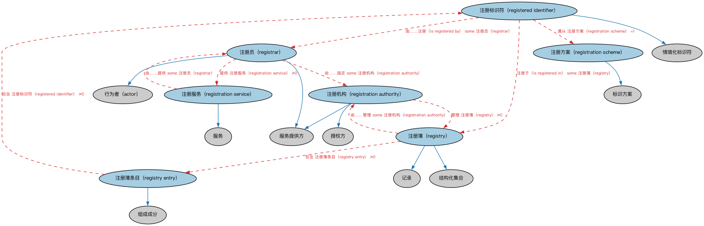

# Commons 注册机构本体（Commons Registration Authorities Ontology）结构与公理说明

本文档对应 `RegistrationAuthorities.rdf` / `RegistrationAuthorities.ttl`，说明该本体的类、继承关系、属性和公理约定。结构图见 `RegistrationAuthorities-structure.png`（`RegistrationAuthorities-structure.svg` 为可缩放版本）。

## 1. 本体概述

定义登记主管机构（registration authority）：负责受理登记、维护登记册、颁发注册证明的机构及其登记行为。

**在体系中的位置**：Commons 中处理「注册与登记」的业务模块。

**上下游关系**：上游依赖业务授权、组织、参与方、文档、标识符、日期等模块；下游被需要表达「在哪注册、由谁登记」的场景引用（如企业注册、证券登记）。

**与相近概念的差别**：登记机构≠监管机构——登记机构负责「记录与发照」，监管机构负责「监督与执法」；登记行为是一种特殊的授权。

本本体中类与类的核心关系如下（完整细节见各类小节）：

- **注册标识符（registered identifier）** 继承 **情境化标识符（ContextualIdentifier）**
- **注册员（registrar）** 继承 **服务提供方（ServiceProvider）**
- **注册员（registrar）** 继承 **行为者（actor）**
- **注册机构（registration authority）** 继承 **授权方（AuthorizingParty）**
- **注册机构（registration authority）** 继承 **服务提供方（ServiceProvider）**
- **注册方案（registration scheme）** 继承 **标识方案（IdentificationScheme）**
- **注册服务（registration service）** 继承 **服务（Service）**
- **注册簿（registry）** 继承 **结构化集合（StructuredCollection）**
- **注册簿（registry）** 继承 **记录（Record）**
- **注册簿条目（registry entry）** 继承 **组成成分（Constituent）**

## 2. 类（Class）

| 类（Class） | 定义（Definition） |
|---|---|
| 注册标识符（registered identifier） | 由注册机构或其代表按某注册方案在注册簿中登记的情境化标识符。 contextual identifier that is registered in a registry by, or on behalf of, a registration authority according to some registration scheme |
| 注册员（registrar） | 作为注册机构代表提供注册服务（含官方记录保存）的参与方角色。 role of a party that acts as a representative of a registration authority to provide registration services, including official record keeping |
| 注册机构（registration authority） | 官方负责维护注册簿并提供注册服务、和/或将部分或全部职责委托给注册员的服务提供方。 service provider that is officially responsible for maintaining a registry and providing registration services and/or for delegating of some or all of these roles to a registrar |
| 注册方案（registration scheme） | 组织注册簿中信息并为登记条目分配标识符的方案。 scheme for organizing information in a registry and allocating identifiers to registered items |
| 注册服务（registration service） | 为个人和/或组织提供在注册簿中登记条目的服务。 service provided to individuals and/or organizations for the registration of items in a registry |
| 注册簿（registry） | 与某事物相关的权威记录或记录集合。 authoritative record or collection of records relating to something |
| 注册簿条目（registry entry） | 注册簿的组成成分，包含登记于其中的某事物的详细信息。 constituent of a registry that includes the details for something recorded in that registry |

以下按类逐个展开：每个类给出继承关系、相关属性与公理约定；子类在父类之下降一级编号。

### 2.1 注册标识符（registered identifier）

定义：由注册机构或其代表按某注册方案在注册簿中登记的情境化标识符。

- 父类：**情境化标识符（ContextualIdentifier）**

属性：

| 属性 | 定义 | 说明 |
|---|---|---|
| **遵从（compliesWith）** | — | — |
| **具有注册日期（has registration date）** | 标识某事物登记的日期或日期时间。 indicates the date or date and time on which something is registered | 值域：cmns-dt:CombinedDateTime；子属性：具有观测日期时间 |
| **由……注册（is registered by）** | 标识注册某事物的注册机构或注册员。 indicates the registration authority or registrar that registers something | 值域：注册员（registrar）；子属性：具有参与方角色（has party role） |
| **注册于（is registered in）** | 标识某事物登记所在的注册簿。 indicates the registry that something is registered in | 值域：注册簿（registry）；子属性：引用 |

公理：

- **具有注册日期（has registration date）**存在取值约束。
- **注册于（is registered in）**至少有一个取值，类型是**注册簿（registry）**。
- **由……注册（is registered by）**至少有一个取值，类型是**注册员（registrar）**。
- **遵从（compliesWith）**恰好有 1 个**注册方案（registration scheme）**。

### 2.2 注册员（registrar）

定义：作为注册机构代表提供注册服务（含官方记录保存）的参与方角色。

- 父类：**服务提供方（ServiceProvider）**、**行为者（actor）**

属性：

| 属性 | 定义 | 说明 |
|---|---|---|
| **由……指定（isDesignatedBy）** | — | — |
| **提供（provides）** | — | — |
| **登记（registers）** | 将某事物记录于注册簿或档案中。 records something in a registry or archive | 逆属性：由……注册（is registered by）；子属性：记录 |

公理：

- **提供（provides）**可以有 0 个或多个**注册服务（registration service）**。
- **由……指定（isDesignatedBy）**至少有一个取值，类型是**注册机构（registration authority）**。
- **登记（registers）**至少有一个取值，类型是**owl:Thing（Thing）**。

### 2.3 注册机构（registration authority）

定义：官方负责维护注册簿并提供注册服务、和/或将部分或全部职责委托给注册员的服务提供方。

- 父类：**授权方（AuthorizingParty）**、**服务提供方（ServiceProvider）**

属性：

| 属性 | 定义 | 说明 |
|---|---|---|
| **管理（manages）** | — | — |
| **是……的注册机构（is registration authority for）** | 标识注册机构所签发的某事物（通常是标识符或代码）。 indicates something (typically an identifier or code) that the registration authority issues | 子属性：是…中的角色（is role in） |

公理：

- **是……的注册机构（is registration authority for）**至少有 0 个取值。
- **管理（manages）**可以有 0 个或多个**注册簿（registry）**。

### 2.4 注册方案（registration scheme）

定义：组织注册簿中信息并为登记条目分配标识符的方案。

- 父类：**标识方案（IdentificationScheme）**

### 2.5 注册服务（registration service）

定义：为个人和/或组织提供在注册簿中登记条目的服务。

- 父类：**服务（Service）**

属性：

| 属性 | 定义 | 说明 |
|---|---|---|
| **由……提供（isProvidedBy）** | — | — |

公理：

- **由……提供（isProvidedBy）**至少有一个取值，类型是**注册员（registrar）**。

### 2.6 注册簿（registry）

定义：与某事物相关的权威记录或记录集合。

- 父类：**结构化集合（StructuredCollection）**、**记录（Record）**

属性：

| 属性 | 定义 | 说明 |
|---|---|---|
| **包含（comprises）** | — | — |
| **由……管理（isManagedBy）** | — | — |

公理：

- **包含（comprises）**可以有 0 个或多个**注册簿条目（registry entry）**。
- **由……管理（isManagedBy）**至少有一个取值，类型是**注册机构（registration authority）**。

### 2.7 注册簿条目（registry entry）

定义：注册簿的组成成分，包含登记于其中的某事物的详细信息。

- 父类：**组成成分（Constituent）**

属性：

| 属性 | 定义 | 说明 |
|---|---|---|
| **包含（comprises）** | — | — |
| **被包含于（isIncludedIn）** | — | — |

公理：

- **包含（comprises）**可以有 0 个或多个**注册标识符（registered identifier）**。
- **被包含于（isIncludedIn）**的所有取值只能是**注册簿（registry）**。

## 3. 其他属性

以下属性未绑定到本体的具体类（定义域在外部本体或未声明）：

对象属性（Object Property）：

| 属性 | 定义 | 说明 |
|---|---|---|
| **具有注册机构（has registration authority）** | 标识某事物的注册机构。 indicates the registration authority for something | 值域：注册机构（registration authority）；逆属性：是……的注册机构（is registration authority for）；子属性：具有参与方角色（has party role） |

## 4. 依赖（owl:imports，10 个）

本本体通过 `owl:imports` 引入以下本体，各项的中文名称与简介如下：

| 导入本体 | 中文名称 | 简介 |
|---|---|---|
| `AnnotationVocabulary/AnnotationVocabulary.rdf` | Commons 标注词汇表（Commons Annotation Vocabulary） | 提供文档标注常用的属性，如摘要、定义、解释、版权、同义词等，并梳理 SKOS 与 Dublin Core 标注属性之间的关系。 |
| `BusinessAuthorizations/BusinessAuthorizations.rdf` | Commons 业务授权本体（Commons Business Authorizations Ontology） | 定义业务授权、许可及其相关角色和关系。 |
| `Collections/Collections.rdf` | Commons 集合本体（Commons Collections Ontology） | 定义集合、成员关系及集合操作的基础概念。 |
| `ContextualIdentifiers/ContextualIdentifiers.rdf` | Commons 上下文标识符本体（Commons Contextual Identifiers Ontology） | 定义在特定上下文或情境中使用的标识符。 |
| `DatesAndTimes/DatesAndTimes.rdf` | Commons 日期与时间本体（Commons Dates and Times Ontology） | 定义日期、时间、时间段及其表示方式。 |
| `Documents/Documents.rdf` | Commons 文档本体（Commons Documents Ontology） | 定义文档、记录及其组成部分的通用概念。 |
| `Identifiers/Identifiers.rdf` | Commons 标识符本体（Commons Identifiers Ontology） | 定义标识符及其发布、管理与解析的基础概念。 |
| `Organizations/Organizations.rdf` | Commons 组织本体（Commons Organizations Ontology） | 定义组织、组织单元及其标识和关系。 |
| `PartiesAndSituations/PartiesAndSituations.rdf` | Commons 参与方与情境本体（Commons Parties and Situations Ontology） | 定义参与方、角色、情境以及它们之间关系的高层概念，是 FIBO 等多领域的上层本体。 |
| `RolesAndCompositions/RolesAndCompositions.rdf` | Commons 角色与组合本体（Commons Roles and Compositions Ontology） | 定义角色、组合及其扮演/组成关系的基础本体。 |

## 5. 文件

- 官方 RDF/XML：`RegistrationAuthorities.rdf`
- 中文 Turtle：`RegistrationAuthorities.ttl`
- 结构图：`RegistrationAuthorities-structure.png` / `RegistrationAuthorities-structure.svg`