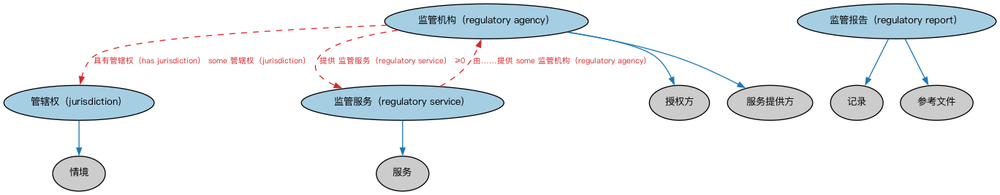

# Commons 监管机构本体（Commons Regulatory Agencies Ontology）结构与公理说明

本文档对应 `RegulatoryAgencies.rdf` / `RegulatoryAgencies.ttl`，说明该本体的类、继承关系、属性和公理约定。结构图见 `RegulatoryAgencies-structure.png`（`RegulatoryAgencies-structure.svg` 为可缩放版本）。

## 1. 本体概述

定义监管机构（regulatory agency）：依法设立、对特定行业或活动行使监督职权的机构及其管辖范围。

**在体系中的位置**：Commons 中处理「监管」的业务模块，是 FIBO 各国监管机构本体的上层基础。

**上下游关系**：上游依赖业务授权、组织、地点、文档、参与方等模块；下游被场所与设施模块及 FIBO 监管体系引用。

**与相近概念的差别**：监管机构≠登记机构——监管重「持续监督合规」，登记重「主体注册」；监管权来自法律授权，这是它与一般行业自律组织的差别。

本本体中类与类的核心关系如下（完整细节见各类小节）：

- **管辖权（jurisdiction）** 继承 **情境（Context）**
- **监管机构（regulatory agency）** 继承 **授权方（AuthorizingParty）**
- **监管机构（regulatory agency）** 继承 **服务提供方（ServiceProvider）**
- **监管报告（regulatory report）** 继承 **记录（Record）**
- **监管报告（regulatory report）** 继承 **参考文件（ReferenceDocument）**
- **监管服务（regulatory service）** 继承 **服务（Service）**

## 2. 类（Class）

| 类（Class） | 定义（Definition） |
|---|---|
| 管辖权（jurisdiction） | 法院或监管机构就特定地理区域裁决案件、发布命令以及解释和适用法律的权力。 power of a court or regulatory agency to adjudicate cases, issue orders, and interpret and apply the law with respect to some specific geographic area |
| 监管机构（regulatory agency） | 负责以监管或监督身份对某事物行使权力的公共当局或政府机构。 public authority or government agency responsible for exercising authority over something in a regulatory or supervisory capacity |
| 监管报告（regulatory report） | 为支持运营透明度、证明符合监管机构规定的某项规范、法律、政策、限制或其他规则而要求的文件。 document required to support operational transparency that demonstrates compliance with some specification, law, policy, restriction, or other rule specified by a regulatory agency |
| 监管服务（regulatory service） | 监管机构提供的服务，可包括但不限于检查、监测、监督、测试等能力。 service provided by a regulatory agency, which may include, but not be limited to, examination, monitoring, supervision, testing, or other capabilities required to ensure the integrity, fairness, safety, or other capacity of a given industry, organization, or product |

以下按类逐个展开：每个类给出继承关系、相关属性与公理约定；子类在父类之下降一级编号。

### 2.1 管辖权（jurisdiction）

定义：法院或监管机构就特定地理区域裁决案件、发布命令以及解释和适用法律的权力。

- 父类：**情境（Context）**

属性：

| 属性 | 定义 | 说明 |
|---|---|---|
| **具有覆盖范围（has reach）** | 标识该管辖权覆盖的地理区域。 indicates the geographic region covered by the jurisdiction | 值域：地理区域；子属性：适用于情境 |
| **是……的管辖权（is jurisdiction of）** | 将管辖权关联到对其拥有一定程度法律权力的政体、政府实体或法院。 relates a jurisdiction to a polity or other government entity or court that has some level of legal authority over it | 逆属性：具有管辖权（has jurisdiction）；子属性：受……管辖（is governed by） |

公理：

- **具有覆盖范围（has reach）**至少有一个取值，类型是**地理区域（GeographicRegion）**。

### 2.2 监管机构（regulatory agency）

定义：负责以监管或监督身份对某事物行使权力的公共当局或政府机构。

- 父类：**授权方（AuthorizingParty）**、**服务提供方（ServiceProvider）**

属性：

| 属性 | 定义 | 说明 |
|---|---|---|
| **提供（provides）** | — | — |
| **具有管辖权（has jurisdiction）** | 将政体、政府实体或监管机构关联到其拥有一定程度法律权力的管辖权。 relates a polity, government entity or regulatory agency to a jurisdiction over which it has some level of legal authority | 值域：管辖权（jurisdiction）；子属性：管辖（governs） |
| **监管（regulates）** | 对……具有监管权或按规则或法律加以指导，对象通常是行业、组织或产品。 has regulatory authority over or directs according to rule or law, typically an industry, organization, or product | 子属性：管辖（governs） |

公理：

- **具有管辖权（has jurisdiction）**至少有一个取值，类型是**管辖权（jurisdiction）**。
- **提供（provides）**可以有 0 个或多个**监管服务（regulatory service）**。
- **监管（regulates）**至少有 0 个取值。

### 2.3 监管报告（regulatory report）

定义：为支持运营透明度、证明符合监管机构规定的某项规范、法律、政策、限制或其他规则而要求的文件。

- 父类：**记录（Record）**、**参考文件（ReferenceDocument）**

### 2.4 监管服务（regulatory service）

定义：监管机构提供的服务，可包括但不限于检查、监测、监督、测试等能力。

- 父类：**服务（Service）**

属性：

| 属性 | 定义 | 说明 |
|---|---|---|
| **由……提供（isProvidedBy）** | — | — |

公理：

- **由……提供（isProvidedBy）**至少有一个取值，类型是**监管机构（regulatory agency）**。

## 3. 其他属性

以下属性未绑定到本体的具体类（定义域在外部本体或未声明）：

对象属性（Object Property）：

| 属性 | 定义 | 说明 |
|---|---|---|
| **管辖（governs）** | 对……拥有并行使权力。 has and exercises authority over | — |
| **适用于管辖区（is applicable in jurisdiction）** | 标识某事物适用之管辖区的地缘政治区域标识符。 indicates the geopolitical region identifier for the jurisdiction in which something is applicable | — |
| **受……管辖（is governed by）** | 将合同、协议、管辖权或其他法律构造关联到规制或监督（管辖）它的规章、政策、程序或法律主体。 relates a contract, agreement, jurisdiction, or other legal construct and the regulation, policy, procedure, or legal person that regulates or oversees (governs) it | 逆属性：管辖（governs） |
| **组建于（is organized in）** | 标识法律实体据以组建的法律所属管辖区。 indicates the jurisdiction whose laws a legal entity is organized under | 值域：管辖权（jurisdiction）；子属性：获承认于（is recognized in） |
| **获承认于（is recognized in）** | 标识法律主体被认为有能力订立合同、开展业务或参与其他活动、或协议可被承认并可能可执行的管辖区。 indicates the jurisdiction in which a legal person is considered competent to enter into a contract, conduct business, or participate in other activities, or in which an agreement may be acknowledged and possibly enforceable | 值域：管辖权（jurisdiction）；子属性：受……管辖（is governed by） |
| **受……监管（is regulated by）** | 指明对某事物具有监管权的监管机构。 specifies a regulatory agency that has regulatory authority for something | 值域：监管机构（regulatory agency）；子属性：具有参与方角色（has party role） |

## 4. 依赖（owl:imports，9 个）

本本体通过 `owl:imports` 引入以下本体，各项的中文名称与简介如下：

| 导入本体 | 中文名称 | 简介 |
|---|---|---|
| `AnnotationVocabulary/AnnotationVocabulary.rdf` | Commons 标注词汇表（Commons Annotation Vocabulary） | 提供文档标注常用的属性，如摘要、定义、解释、版权、同义词等，并梳理 SKOS 与 Dublin Core 标注属性之间的关系。 |
| `BusinessAuthorizations/BusinessAuthorizations.rdf` | Commons 业务授权本体（Commons Business Authorizations Ontology） | 定义业务授权、许可及其相关角色和关系。 |
| `ContextualDesignators/ContextualDesignators.rdf` | Commons 上下文指称本体（Commons Contextual Designators Ontology） | 定义在特定上下文中有意义的指称、名称和标识符。 |
| `Documents/Documents.rdf` | Commons 文档本体（Commons Documents Ontology） | 定义文档、记录及其组成部分的通用概念。 |
| `Identifiers/Identifiers.rdf` | Commons 标识符本体（Commons Identifiers Ontology） | 定义标识符及其发布、管理与解析的基础概念。 |
| `Locations/Locations.rdf` | Commons 位置本体（Commons Locations Ontology） | 定义地址、地理区域、位置及其关系。 |
| `Organizations/Organizations.rdf` | Commons 组织本体（Commons Organizations Ontology） | 定义组织、组织单元及其标识和关系。 |
| `PartiesAndSituations/PartiesAndSituations.rdf` | Commons 参与方与情境本体（Commons Parties and Situations Ontology） | 定义参与方、角色、情境以及它们之间关系的高层概念，是 FIBO 等多领域的上层本体。 |
| `RolesAndCompositions/RolesAndCompositions.rdf` | Commons 角色与组合本体（Commons Roles and Compositions Ontology） | 定义角色、组合及其扮演/组成关系的基础本体。 |

## 5. 文件

- 官方 RDF/XML：`RegulatoryAgencies.rdf`
- 中文 Turtle：`RegulatoryAgencies.ttl`
- 结构图：`RegulatoryAgencies-structure.png` / `RegulatoryAgencies-structure.svg`