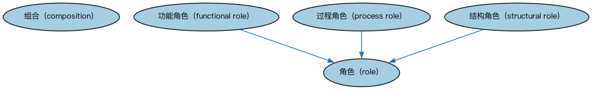

# Commons 角色与组合本体（Commons Roles and Compositions Ontology）结构与公理说明

本文档对应 `RolesAndCompositions.rdf` / `RolesAndCompositions.ttl`，说明该本体的类、继承关系、属性和公理约定。结构图见 `RolesAndCompositions-structure.png`（`RolesAndCompositions-structure.svg` 为可缩放版本）。

## 1. 本体概述

定义角色（role）与组合（composition）：某事物在特定情境中扮演的部分，以及「整体由部分组成」的结构，含功能角色、结构角色、过程角色三类。

**在体系中的位置**：Commons 的机制性基础模块，参与方与情境模块的角色机制直接建立在它之上。

**上下游关系**：上游依赖集合、语境指称、指称符、日期模块；下游被参与方与情境、组织、业务授权、登记与监管模块引用。

**与相近概念的差别**：角色≠类——「董事长」不是人的类别，而是人在特定组织情境中扮演的角色（同一人可兼任多角）；组合≠集合——组合强调「为特定目的组织起来的整体」，集合只是成员的汇集。

本本体中类与类的核心关系如下（完整细节见各类小节）：

- **功能角色（functional role）** 继承 **角色（role）**
- **过程角色（process role）** 继承 **角色（role）**
- **结构角色（structural role）** 继承 **角色（role）**

## 2. 类（Class）

| 类（Class） | 定义（Definition） |
|---|---|
| 组合（composition） | 为特定目的将其他事物（可能以特定角色）组合在一起而形成的特定产物。 |
| 功能角色（functional role） | 表示某人、组织、过程或服务预期执行或提供的底层功能的角色。 |
| 过程角色（process role） | 将资源和参与者关联到为特定目的设计并组织的一组涉及多个企业实体的结构化活动的角色。 |
| 角色（role） | 某事物在特定情境中参与的命名具体行为。 |
| 结构角色（structural role） | 以能力意义指定实体之间关系的角色，通常反映组织或结构关系（层级）。 |

以下按类逐个展开：每个类给出继承关系、相关属性与公理约定；子类在父类之下降一级编号。

### 2.1 组合（composition）

定义：为特定目的将其他事物（可能以特定角色）组合在一起而形成的特定产物。

属性：

| 属性 | 定义 | 说明 |
|---|---|---|
| **具有组成成分（hasConstituent）** | — | — |
| **适用于情境（isApplicableIn）** | — | — |
| **具有角色（has role）** | 识别在某事物（例如组合）中扮演部分的角色。 | 值域：角色（role） |

公理：

- **具有组成成分（hasConstituent）**的所有取值只能是**组成成分（Constituent）**。
- **具有角色（has role）**的所有取值只能是**角色（role）**。
- **适用于情境（isApplicableIn）**可以有 0 个或多个**情境（Context）**。

### 2.2 角色（role）

定义：某事物在特定情境中参与的命名具体行为。

- 直接子类：**功能角色（functional role）**、**过程角色（process role）**、**结构角色（structural role）**

属性：

| 属性 | 定义 | 说明 |
|---|---|---|
| **体现在…中（is manifested in）** | 指示角色在其中实现、出现或发生的事物。 | 逆属性：体现（manifests） |
| **由…扮演（is played by）** | 指示填充该角色的人、组织或其他事物。 | 逆属性：扮演角色（plays role） |
| **是…中的角色（is role in）** | 识别涉及该角色的某事物，例如组合、情境或合同。 | 逆属性：具有角色（has role） |

公理：

- **由…扮演（is played by）**至少有 0 个取值。

#### 2.2.1 功能角色（functional role）

定义：表示某人、组织、过程或服务预期执行或提供的底层功能的角色。

- 父类：**角色（role）**

#### 2.2.2 过程角色（process role）

定义：将资源和参与者关联到为特定目的设计并组织的一组涉及多个企业实体的结构化活动的角色。

- 父类：**角色（role）**

#### 2.2.3 结构角色（structural role）

定义：以能力意义指定实体之间关系的角色，通常反映组织或结构关系（层级）。

- 父类：**角色（role）**

## 3. 其他属性

以下属性未绑定到本体的具体类（定义域在外部本体或未声明）：

对象属性（Object Property）：

| 属性 | 定义 | 说明 |
|---|---|---|
| **体现（manifests）** | 指示在某种情境中实现、展示或显示某事物的角色。 | 值域：角色（role） |
| **扮演角色（plays role）** | 指示某人或某事物在某种情境下所扮演的部分。 | 值域：角色（role） |

## 4. 依赖（owl:imports，5 个）

本本体通过 `owl:imports` 引入以下本体，各项的中文名称与简介如下：

| 导入本体 | 中文名称 | 简介 |
|---|---|---|
| `AnnotationVocabulary/AnnotationVocabulary.rdf` | Commons 标注词汇表（Commons Annotation Vocabulary） | 提供文档标注常用的属性，如摘要、定义、解释、版权、同义词等，并梳理 SKOS 与 Dublin Core 标注属性之间的关系。 |
| `Collections/Collections.rdf` | Commons 集合本体（Commons Collections Ontology） | 定义集合、成员关系及集合操作的基础概念。 |
| `ContextualDesignators/ContextualDesignators.rdf` | Commons 上下文指称本体（Commons Contextual Designators Ontology） | 定义在特定上下文中有意义的指称、名称和标识符。 |
| `DatesAndTimes/DatesAndTimes.rdf` | Commons 日期与时间本体（Commons Dates and Times Ontology） | 定义日期、时间、时间段及其表示方式。 |
| `Designators/Designators.rdf` | Commons 指称本体（Commons Designators Ontology） | 定义名称、标识符等指称事物的通用概念。 |

## 5. 文件

- 官方 RDF/XML：`RolesAndCompositions.rdf`
- 中文 Turtle：`RolesAndCompositions.ttl`
- 结构图：`RolesAndCompositions-structure.png` / `RolesAndCompositions-structure.svg`