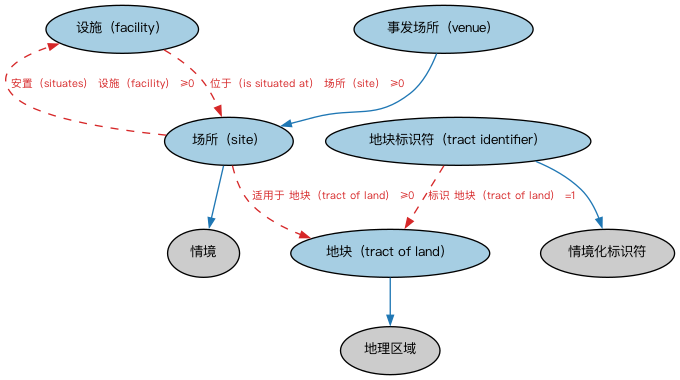

# Commons 场所与设施本体（Commons Sites and Facilities Ontology）结构与公理说明

本文档对应 `SitesAndFacilities.rdf` / `SitesAndFacilities.ttl`，说明该本体的类、继承关系、属性和公理约定。结构图见 `SitesAndFacilities-structure.png`（`SitesAndFacilities-structure.svg` 为可缩放版本）。

## 1. 本体概述

定义场所（site）与设施（facility）：有特定用途的物理空间及其配套，如办公楼、工厂、数据中心。

**在体系中的位置**：Commons 中处理「物理空间与用途」的业务模块。

**上下游关系**：上游依赖地点、组织、监管机构、语境标识符等模块；下游被需要表达经营场所、注册地址实体化的场景引用。

**与相近概念的差别**：场所≠地点——地点是抽象空间位置，场所是「有用途、有边界」的具体空间；设施强调场所内的功能设备与配套。

本本体中类与类的核心关系如下（完整细节见各类小节）：

- **场所（site）** 继承 **情境（Context）**
- **地块标识符（tract identifier）** 继承 **情境化标识符（ContextualIdentifier）**
- **地块（tract of land）** 继承 **地理区域（GeographicRegion）**
- **事发场所（venue）** 继承 **场所（site）**

## 2. 类（Class）

| 类（Class） | 定义（Definition） |
|---|---|
| 设施（facility） | 为服务特定目的、使某行动或操作更便利、或提供某种能力或服务而设立的事物。 something established to serve a particular purpose, make some course of action or operation easier, or provide some capability or service |
| 场所（site） | 某事物（如设施）所处的地点、环境或情境。 place, setting, or context in which something, such as a facility, is situated |
| 地块标识符（tract identifier） | 在某管辖区内签发使用的地块唯一标识符。 unique identifier for a parcel issued for use in some jurisdiction |
| 地块（tract of land） | 地球表面较大区域内一块连续的土地，通常按契约、勘测或法律文件所述边界界定。 geographic region that is a contiguous parcel or area of land within a larger region on the surface of the earth, typically defined by its boundaries as described in a deed, survey, or legal document |
| 事发场所（venue） | 某事发生的场所，以在该处发生的事件、活动或其他事物为情境来描述。 site where something happens, described in the context of an event, activity, or something else that occurs there |

以下按类逐个展开：每个类给出继承关系、相关属性与公理约定；子类在父类之下降一级编号。

### 2.1 设施（facility）

定义：为服务特定目的、使某行动或操作更便利、或提供某种能力或服务而设立的事物。

属性：

| 属性 | 定义 | 说明 |
|---|---|---|
| **使能（enables）** | 创造使某事能够发生或高效运转的环境或情形。 creates an environment or situation where something can occur or function efficiently | — |
| **位于（is situated at）** | 坐落于。 is placed at | — |

公理：

- **位于（is situated at）**可以有 0 个或多个**场所（site）**。
- **使能（enables）**可以有 0 个或多个**Ndb0088586e4f45d68ef69c3caf5afd25**。

### 2.2 场所（site）

定义：某事物（如设施）所处的地点、环境或情境。

- 父类：**情境（Context）**
- 直接子类：**事发场所（venue）**

属性：

| 属性 | 定义 | 说明 |
|---|---|---|
| **适用于（appliesTo）** | — | — |
| **安置（situates）** | 标识某事物所处的地点、环境或情境。 indicates the place, setting, or context in which something is placed | 逆属性：位于（is situated at） |

公理：

- **安置（situates）**可以有 0 个或多个**设施（facility）**。
- **适用于（appliesTo）**可以有 0 个或多个**地块（tract of land）**。

#### 2.2.1 事发场所（venue）

定义：某事发生的场所，以在该处发生的事件、活动或其他事物为情境来描述。

- 父类：**场所（site）**

属性：

| 属性 | 定义 | 说明 |
|---|---|---|
| **适用于情境（isApplicableIn）** | — | — |

公理：

- **适用于情境（isApplicableIn）**可以有 0 个或多个**情境（Context）**。

### 2.3 地块标识符（tract identifier）

定义：在某管辖区内签发使用的地块唯一标识符。

- 父类：**情境化标识符（ContextualIdentifier）**

属性：

| 属性 | 定义 | 说明 |
|---|---|---|
| **适用于情境（isApplicableIn）** | — | — |
| **标识（identifies）** | — | — |

公理：

- **标识（identifies）**恰好有 1 个**地块（tract of land）**。
- **适用于情境（isApplicableIn）**可以有 0 个或多个**管辖权（Jurisdiction）**。

### 2.4 地块（tract of land）

定义：地球表面较大区域内一块连续的土地，通常按契约、勘测或法律文件所述边界界定。

- 父类：**地理区域（GeographicRegion）**

属性：

| 属性 | 定义 | 说明 |
|---|---|---|
| **是……的子区域（isSubregionOf）** | — | — |

公理：

- **是……的子区域（isSubregionOf）**至少有一个取值，类型是**地理区域（GeographicRegion）**。

## 3. 其他属性

以下属性未绑定到本体的具体类（定义域在外部本体或未声明）：

对象属性（Object Property）：

| 属性 | 定义 | 说明 |
|---|---|---|
| **由……使能（is enabled by）** | 标识某事物因之得以发生或高效运转的事物。 indicates something that occurs or functions efficiently due to | 逆属性：使能（enables） |

## 4. 依赖（owl:imports，7 个）

本本体通过 `owl:imports` 引入以下本体，各项的中文名称与简介如下：

| 导入本体 | 中文名称 | 简介 |
|---|---|---|
| `AnnotationVocabulary/AnnotationVocabulary.rdf` | Commons 标注词汇表（Commons Annotation Vocabulary） | 提供文档标注常用的属性，如摘要、定义、解释、版权、同义词等，并梳理 SKOS 与 Dublin Core 标注属性之间的关系。 |
| `ContextualDesignators/ContextualDesignators.rdf` | Commons 上下文指称本体（Commons Contextual Designators Ontology） | 定义在特定上下文中有意义的指称、名称和标识符。 |
| `ContextualIdentifiers/ContextualIdentifiers.rdf` | Commons 上下文标识符本体（Commons Contextual Identifiers Ontology） | 定义在特定上下文或情境中使用的标识符。 |
| `Identifiers/Identifiers.rdf` | Commons 标识符本体（Commons Identifiers Ontology） | 定义标识符及其发布、管理与解析的基础概念。 |
| `Locations/Locations.rdf` | Commons 位置本体（Commons Locations Ontology） | 定义地址、地理区域、位置及其关系。 |
| `Organizations/Organizations.rdf` | Commons 组织本体（Commons Organizations Ontology） | 定义组织、组织单元及其标识和关系。 |
| `RegulatoryAgencies/RegulatoryAgencies.rdf` | Commons 监管机构本体（Commons Regulatory Agencies Ontology） | 定义监管机构、监管角色及其关系。 |

## 5. 文件

- 官方 RDF/XML：`SitesAndFacilities.rdf`
- 中文 Turtle：`SitesAndFacilities.ttl`
- 结构图：`SitesAndFacilities-structure.png` / `SitesAndFacilities-structure.svg`