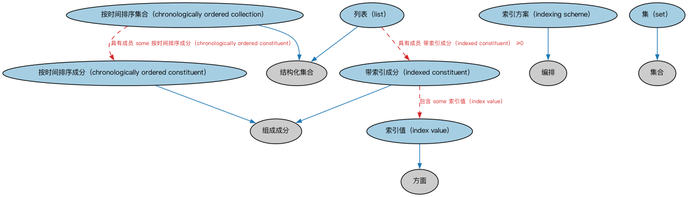

# Commons 结构化集合本体（Commons Structured Collections Ontology）结构与公理说明

本文档对应 `StructuredCollections.rdf` / `StructuredCollections.ttl`，说明该本体的类、继承关系、属性和公理约定。结构图见 `StructuredCollections-structure.png`（`StructuredCollections-structure.svg` 为可缩放版本）。

## 1. 本体概述

定义结构化集合：具有内部结构或模式的集合，如序列（sequence）、层次结构（hierarchy）、表格结构。

**在体系中的位置**：Commons 的构件模块，是集合（Collections）的扩展。

**上下游关系**：上游依赖集合、分类、指称符、日期、文档模块；下游被需要表达有序、分层数据的场景引用。

**与相近概念的差别**：结构化集合≠集合——集合只有成员关系，结构化集合增加了顺序、层级等内部组织；与分类方案的差别——分类方案管「归类」，结构化集合管「怎么排列」。

本本体中类与类的核心关系如下（完整细节见各类小节）：

- **按时间排序集合（chronologically ordered collection）** 继承 **结构化集合（StructuredCollection）**
- **按时间排序成分（chronologically ordered constituent）** 继承 **组成成分（Constituent）**
- **索引值（index value）** 继承 **方面（Aspect）**
- **带索引成分（indexed constituent）** 继承 **组成成分（Constituent）**
- **索引方案（indexing scheme）** 继承 **编排（Arrangement）**
- **列表（list）** 继承 **结构化集合（StructuredCollection）**
- **集（set）** 继承 **集合（Collection）**

## 2. 类（Class）

| 类（Class） | 定义（Definition） |
|---|---|
| 按时间排序集合（chronologically ordered collection） | 元素按时间排序的结构化集合。 |
| 按时间排序成分（chronologically ordered constituent） | 在集合中按时间排序的集合元素。 |
| 索引值（index value） | 集合或检索系统中指示元素在记录、列表或文档中所在位置的方面。 |
| 带索引成分（indexed constituent） | 在集合中按索引排序的集合元素。 |
| 索引方案（indexing scheme） | 对值、数据、信息或知识进行索引的体系。 |
| 列表（list） | 有限的线性有序项集合，同一项可出现多次。 |
| 集（set） | 作为整体考虑的不同对象或概念的汇集。 |

以下按类逐个展开：每个类给出继承关系、相关属性与公理约定；子类在父类之下降一级编号。

### 2.1 按时间排序集合（chronologically ordered collection）

定义：元素按时间排序的结构化集合。

- 父类：**结构化集合（StructuredCollection）**

属性：

| 属性 | 定义 | 说明 |
|---|---|---|
| **具有成员（hasMember）** | — | — |

公理：

- **具有成员（hasMember）**至少有一个取值，类型是**按时间排序成分（chronologically ordered constituent）**。

### 2.2 按时间排序成分（chronologically ordered constituent）

定义：在集合中按时间排序的集合元素。

- 父类：**组成成分（Constituent）**

属性：

| 属性 | 定义 | 说明 |
|---|---|---|
| **具有观测日期时间（hasObservedDateTime）** | — | — |

公理：

- **具有观测日期时间（hasObservedDateTime）**存在取值约束。

### 2.3 索引值（index value）

定义：集合或检索系统中指示元素在记录、列表或文档中所在位置的方面。

- 父类：**方面（Aspect）**

属性：

| 属性 | 定义 | 说明 |
|---|---|---|
| **定义于（isDefinedIn）** | — | — |
| **引用（refersTo）** | — | — |

公理：

- **定义于（isDefinedIn）**的所有取值只能是**索引方案（indexing scheme）**。
- **引用（refersTo）**至少有 0 个取值。

### 2.4 带索引成分（indexed constituent）

定义：在集合中按索引排序的集合元素。

- 父类：**组成成分（Constituent）**

属性：

| 属性 | 定义 | 说明 |
|---|---|---|
| **包含（comprises）** | — | — |

公理：

- **包含（comprises）**至少有一个取值，类型是**索引值（index value）**。

### 2.5 索引方案（indexing scheme）

定义：对值、数据、信息或知识进行索引的体系。

- 父类：**编排（Arrangement）**

属性：

| 属性 | 定义 | 说明 |
|---|---|---|
| **定义（defines）** | — | — |

公理：

- **定义（defines）**的所有取值只能是**索引值（index value）**。

### 2.6 列表（list）

定义：有限的线性有序项集合，同一项可出现多次。

- 父类：**结构化集合（StructuredCollection）**

属性：

| 属性 | 定义 | 说明 |
|---|---|---|
| **具有成员（hasMember）** | — | — |

公理：

- **具有成员（hasMember）**可以有 0 个或多个**带索引成分（indexed constituent）**。

### 2.7 集（set）

定义：作为整体考虑的不同对象或概念的汇集。

- 父类：**集合（Collection）**

## 3. 依赖（owl:imports，6 个）

本本体通过 `owl:imports` 引入以下本体，各项的中文名称与简介如下：

| 导入本体 | 中文名称 | 简介 |
|---|---|---|
| `AnnotationVocabulary/AnnotationVocabulary.rdf` | Commons 标注词汇表（Commons Annotation Vocabulary） | 提供文档标注常用的属性，如摘要、定义、解释、版权、同义词等，并梳理 SKOS 与 Dublin Core 标注属性之间的关系。 |
| `Classifiers/Classifiers.rdf` | Commons 分类器本体（Commons Classifiers Ontology） | 定义用于对事物进行分类、分面或归类的通用概念。 |
| `Collections/Collections.rdf` | Commons 集合本体（Commons Collections Ontology） | 定义集合、成员关系及集合操作的基础概念。 |
| `DatesAndTimes/DatesAndTimes.rdf` | Commons 日期与时间本体（Commons Dates and Times Ontology） | 定义日期、时间、时间段及其表示方式。 |
| `Designators/Designators.rdf` | Commons 指称本体（Commons Designators Ontology） | 定义名称、标识符等指称事物的通用概念。 |
| `Documents/Documents.rdf` | Commons 文档本体（Commons Documents Ontology） | 定义文档、记录及其组成部分的通用概念。 |

## 4. 文件

- 官方 RDF/XML：`StructuredCollections.rdf`
- 中文 Turtle：`StructuredCollections.ttl`
- 结构图：`StructuredCollections-structure.png` / `StructuredCollections-structure.svg`